# План упрощения архитектуры Devflow Diff Explain

**Статус на 4 ноября 2026 года.** В текущем дереве реализованы закреплённые code/review ссылки, неизменный вход вопроса, локальная проверка источников, частичная приёмка файлов, Mermaid-проверка, fencing выдачи, кэш payload и отдельный лимит структурного результата. Действующие контракты описаны в `spec.md`, `architecture.md` и `protocol.md`; ниже остаются исходные мотивы и сценарии приёмки. `route_snapshots` по-прежнему записывает оперативные JSON-статусы. Общий упаковщик байтов и виртуализация ленты UI сознательно не внедрены без измеренного выигрыша. Приёмка реализации: 2410 тестов пакетов, 36 E2E и 5 независимых повторов восстановления чтения прошли. Финальный standalone проверен на отдельной копии сохранённого реального PR: миграция БД 25→30, 50 файлов и 11 источников читаются без агента, сети и экспорта. Подробные результаты — `../qa/architecture-simplification-20261104/README.md`. Новая генерация моделью, смысловая оценка объяснений и парное сравнение скорости/контекста с прямым разбором не выполнялись.

Предлагается сохранить локальное приложение, самостоятельного агента и постепенную публикацию разбора. Основное упрощение — один канонический снимок кода, один формат нового разбора, неизменный вход каждого вопроса и короткий контракт публикации. Исследование и объяснение остаются у агента; версии, хранение, навигация, очередь и проверка ссылок полностью обслуживает приложение.

Первоочередная работа — устранить конкретные разрывы гарантий спецификации: адресуемость старой версии, фиксацию контекста вопроса, доступность опубликованных источников и согласованность схемы с её ссылками. После этого можно удалять дубли представлений и промежуточные механизмы, сохраняя работающие свойства. Переписывать приложение целиком или вводить новый агентский фреймворк не требуется.

Основание: `docs/spec.md`, исходники ревизии `4810cac`, статический разбор 4 ноября 2026 года и сохранённые результаты прежних QA. Новые прогоны приложения и моделей в рамках этого анализа не выполнялись. Это план изменений; действующие требования и реализация им не заменяются.

## Требования и границы упрощения

| Обязательное свойство | Минимальный механизм | Что не следует навязывать агенту |
|---|---|---|
| Понять изменение процесса и его окружение | Свободная схема одного или нескольких процессов; существенные развилки, изменённые элементы и связи, неизвестности | Число узлов, предписанную компоновку, порядок исследования, ручное повторение всех подписей схемы |
| Архитектура → блоки → каждый изменённый файл и обратно | Стабильные ID элементов и блоков, один основной владелец файла, вычисляемые обратные индексы | Искусственные узлы для тестов/документации; второй список файлов для обратной навигации |
| Полный закреплённый материал читается автономно | Полные оригиналы и патчи в собственном хранилище; проверяемые ссылки на точную версию | Перечитывание моделью всех экспортированных байтов |
| Пояснения и ответы проверяются по той же версии | Общая ссылка на сохранённый файл/сторону/диапазон или захват внешнего материала; локальная оговорка при нехватке оснований | Доказательство истинности текста механическими эвристиками, фиктивные evidence из одного владения файлом |
| Вопрос фиксирует версию и явное вложение при отправке | Неизменный вход вопроса со ссылкой на редакцию разбора и историей на момент отправки | Пересылку всего объяснения из браузера; восстановление отправленного контекста из текущего состояния |
| Готовое остаётся доступным при ошибке, отмене и повторе | Атомарная структурная публикация и независимая приёмка пояснений файлов | Обязательные микропакеты, пересдачу уже принятого, полный перезапуск из-за одного файла |
| Вопрос обгоняет оставшуюся подготовку при следующем выборе работы | Долговечная очередь с приоритетом chat на границе выдачи | Вторую модель, принудительное прерывание активного рассуждения, обязательный heartbeat в инструментах исследования |
| Скорость и контекст приближаются к прямому разбору | Короткая выдача работы, повторное использование закреплённых источников, измерение фактического чтения | Лимит глубины исследования или обязательное чтение всех contextFiles |

Спецификация закрепляет эти свойства в `docs/spec.md:5–13,19–47`. Семь пакетов, Mermaid, названия route/skeleton/stop, конкретные TTL, проценты прогресса и форма JSON — технические решения. Их можно менять с сохранением поведения и совместимости. Самодостаточные бандлы и локальная установка полезны и сейчас закреплены `AGENTS.md`; для этой задачи пересмотр упаковки не даёт очевидной выгоды.

Полный нативный экспорт имеет неизбежную стоимость: прямой ответ в чате не обязан сохранять оригиналы для автономного браузера. Импортер проверяет внутреннюю согласованность переданных данных, но без доступа к провайдеру не доказывает полноту его инвентаря. Это остаётся ответственностью нативного экспортирующего инструмента и отдельно проверяется в QA. Продукт не получает PR/VCS-адаптеры или поиск авторизации.

## Устройство проекта и источники сложности

Сейчас сессия агента исследует PR, формирует локальный экспорт, вызывает standalone CLI, а затем получает задания от HTTP-сервера. Сервер хранит SQLite, отдаёт UI и выдаёт `route.prepare` либо `chat`. UI получает изменения через SSE и перечитывает данные через REST. Это подходящая основа: серверу не нужен собственный LLM-клиент, а чтению не нужен агент.

Уже реализованы полезные оптимизации: обзор и все пояснения можно принять одной сдачей; следующие сдачи могут содержать произвольную полезную часть файлов; пути неизменного контекста стабильны; `complete --next` объединяет сдачу и ожидание; evidence чата дедуплицируется с сохранением ссылок каждого владельца. Эти свойства сохраняются.

Основная сложность находится между границами:

- Полный дифф сериализуется в `code_snapshots.data` и независимо в `iterations.diff_json`. Локальный `SnapshotReader` играет роль прежнего хоста, а `IterationFeed` и оркестратор синхронизируют хранилище с самим собой. `code-snapshots.ts:18–20,145–165`, `iteration-store.ts:63–105`, `snapshot-reader.ts:13–29`, `iteration-feed.ts:23–47`.
- Разбор представлен worker DTO, внутренним evidence с claims, route snapshot, explanation compatibility и UI-состоянием. Порядок блоков повторён массивом, `planIndex` и `tourOrder`; файлы вложены в блоки. При перегруппировке нужно переносить их содержимое между представлениями. `protocol/src/route.ts:141–229,426–479`, `server/src/explanation-compat.ts:4–13`, `architecture-story.ts:87–99`.
- Задания, привязки подготовки, результаты файлов, статусы чата и метаданные поколения частично зеркалят друг друга и требуют сверок. Часть различий необходима: выполняемая подготовка и читаемый прежний разбор действительно могут иметь разные состояния. Зеркала одного факта следует убрать. `route-store.ts:185–205,250–278,365–378`, `chat-orchestrator.ts:281–300,340–385`.
- При каждом продолжении заново строятся общий контекст и numbered patches всех файлов, а также сериализуется принятый разбор. Уже существующий файл пропускается после подготовки текста. Это повторная работа CPU/IO; из неё нельзя автоматически выводить расход токенов модели. `route-payload.ts:123–136,225–241,317–333`, `shared-payload.ts:105–121,194–208`.

## Разрывы требований, которые нужно закрыть первыми

Следующие выводы получены из кода; для каждого указан воспроизводимый критерий будущего исправления.

| Проблема | Основание в коде | Требуемое поведение |
|---|---|---|
| Ссылка запуска не адресует версию | `cli/src/format.ts:45–53` выдаёт только token; `ui/src/main.tsx:20–28` читает token/view; `story/app.tsx:48–66,119–137` выбирает cache/current | При работающем сервере сохранить ссылку A, импортировать и открыть B, открыть A в чистом профиле — получить A. После restart тот же снимок открывается по новой авторизованной ссылке. ID кода доступен ещё до первого обзора |
| Браузер пересылает текст объяснения, сервер сравнивает его с изменяемым снимком | `app.tsx:310–317`, `chat-orchestrator.ts:111–123`; лимит текста 40 000 символов в `protocol/src/chat.ts:51–60`, при этом одна Mermaid может занимать 40 000 и иметь дополнительные views | Вопрос отправляется ссылкой на показанную редакцию. Допустимый большой разбор и принятый во время отправки checkpoint не блокируют вопрос |
| Retry заново собирает историю | `chat-orchestrator.ts:162–181,198–210` берёт текущие exchanges; сохраняется вложение/объяснение, но не весь вход | Отправить A, позже завершить B той же версии, повторить A — B не попадает в контекст A. Версии ответов фиксируются, одного cutoff по ID недостаточно |
| Источники и ограничения недоступны у части опубликованного текста | `app.tsx:295–297` скрывает sources обзора; `guided-document.tsx:24–32` не выводит evidence блока; `flow-diagram.tsx:12–17` печатает координаты примера без перехода | Источник, использованный только в блоке, и существенная оговорка доступны рядом с этим блоком. Переход к сохранённому материалу работает после restart без export/payload |
| Сервер и UI по-разному устанавливают существование элемента схемы | `architecture-story.ts:32–49` ищет упоминание ID регуляркой; `architecture-diagram.tsx:10–15,52–94` проверяет фактические SVG-элементы | ID в подписи/комментарии не считается узлом. Ошибка сообщает конкретный вид/ID/причину и относится к хешу текущей схемы |
| Визуальное состояние рёбер теряется | `architecture-diagram.tsx:139–148` приводит рёбра к одному стилю; канонические edges имеют change/sources/limitation | Затронутая, существующая и неизвестная связь различимы; параллельные связи адресуются однозначно; ограничение можно прочитать |
| Плохой элемент файла способен отклонить корректных соседей | `architecture-checkpoint.ts:22–29` отклоняет envelope из-за отсутствующего/повторённого path до пофайловой проверки; `route-orchestrator.ts:507–510` прекращает продолжение при исчерпанном исправлении | Ошибочный элемент/оба дубля отклоняются локально, корректный независимый файл сохраняется. Исчерпанный файл получает ошибку, остальные продолжают готовиться |
| Дополнение старого снимка может изменить код под старым diffId | `code-snapshots.ts:90–111` сверяет legacy inventory/revisions, но принимает explicit patch вместо исторического; `:153–165` сохраняет его через перезаписывающий `IterationStore.upsert` | Дополнение доказывает совместимость с уже сохранённым патчем и адресами. Конфликт не меняет прежние данные; несовместимый материал получает новую версию |
| Отсутствующий legacy-оригинал может читаться из активного снимка | `saved-sources.ts:37–52` вызывает host по revision, а `snapshot-reader.ts:32–35` выбирает активный diffId. Локальные метки base/worktree могут повторяться | Любое чтение получает точный ID кода. При отсутствии байтов A приложение показывает недоступность A, а не байты B |

Дополнительно при изменении соответствующих границ: проверять origin внешнего источника при повторном импорте (`code-snapshots.ts:207–215` сейчас сравнивает только hash/kind); различать выдачи одного задания одному worker (`messages.ts:122–151`, `queue.ts:529–552` не передают отдельный lease token); проверять доступность явного диапазона до постановки вопроса; не открывать более новую схему БД старым writer (`db.ts:104–125`). Это изменения приложения, которые не требуют дополнительных решений модели.

## Целевая модель

Достаточно трёх предметных сущностей и одного технического механизма исполнения. Их можно вводить поверх нынешней SQLite, сохраняя валидируемый JSON разбора. Полная нормализация всех полей в SQL не нужна без доказанной выгоды.

| Сущность | Канонические данные | Производные данные |
|---|---|---|
| `CodeSnapshot` | Неизменный ID, base/head или определённое локальное состояние, инвентарь, пути, типы объектов, hash полных сторон и patch. Дополняемый каталог сохранённых источников с неизменными захватами | Статистика, индексы путей и строк, превью, файлы контекста агента |
| `Review` и редакция разбора | ID разбора, code ID, обзор, схемы, один упорядоченный список блоков со стабильными ID, основной владелец каждого файла. Пояснения хранятся по file ID и переживают перегруппировку | node/group/edge → blocks, file → owner, порядок чтения, готовность, навигационные представления |
| `QuestionInput` и ответы | Текст, code ID, конкретная редакция показанного объяснения, явное вложение либо его отсутствие, язык, зафиксированные версии предыдущих обменов. Попытки и ответы не переписывают вход | Payload для текущей сессии, отображение прогресса и unread |
| `Job` | prepare/chat, владелец работы, закреплённые code/review/question, статус, выдача/attempt, lease token, результат и квитанция | UI-статусы, очередь оставшихся файлов, SSE-уведомления |

`codeSnapshotId`, ID разбора, редакция разбора и ID выдачи задания обозначают разные вещи. Свести их к одному ID означало бы потерять различие между кодом, дополнением пояснений и повторной попыткой. Внешнему агенту эти различия обслуживает CLI; ему не нужно ими управлять вручную.

Каталог использованных источников может пополняться, не меняя идентичность кода. Его редакция/хеш учитывается отдельно в индексе доступного материала. Зафиксированы показанное объяснение, его ссылки, вложение и выбранные версии истории, а не запрет исследовать новые основания. И при первом ответе, и при повторе агент может дочитать материал той же версии и явно сохранить его перед публикацией. Новый источник не перезаписывает старый захват; новый ответ другого вопроса не попадает в замороженную историю.

`latestImported`, выбранный читателем код и выполняемая подготовка — отдельные ссылки. Новый импорт обновляет первую; человек меняет вторую; уже выданное задание сохраняет третью. В URL находятся адресуемые code/review и при необходимости конкретная редакция; localStorage хранит позицию, черновик и настройки с областью PR/review. Токен доступа не становится ключом версии.

Стабильный locator проекта/кода/разбора отделён от адреса работающего сервера. Нынешний сервер меняет токен и случайный порт при старте (`server.ts:159,570–586`). Поэтому старый буквальный URL гарантирует выбор версии в пределах доступности этого экземпляра; после restart CLI выдаёт новый авторизованный URL на тот же locator. Стабильный порт или долговечный токен ради этого плана не вводятся: спецификация ограничивает доступность ссылки локальным сервером.

### Поток публикации

```mermaid
flowchart LR
    Native[Нативные инструменты агента] -->|Инвентарь и полные байты| Import[Локальный импорт]
    Import --> Code[CodeSnapshot и сохранённые источники]
    Agent[Агент] -->|Обзор, связи и готовые файлы| Accept[Проверка публикации]
    Code --> Accept
    Accept -->|Одна транзакция| Review[Редакция разбора и квитанция]
    Code --> Read[Производная модель чтения]
    Review --> Read
    Read --> UI[Браузер]
    UI -->|Вопрос, версия и явное вложение| Question[Неизменный вход вопроса]
    Question --> Queue[Очередь prepare и chat]
    Queue -->|Короткая задача и пути к материалам| Agent
```



Разбор может дополняться, но опубликованная редакция, на которую ссылается вопрос, восстанавливается точно. Адрес редакции — scoped `(reviewId, revision)` либо ссылка на полное каноническое содержимое. Нынешний `contentHashOf` исключает идентичность и зависит от статусов (`route-store.ts:832–836`); использовать его как готовый ID редакции нельзя. Lease/progress и диагностические события не создают полную копию текста. Начать можно с JSON редакций; измерить рост БД и CPU записи при маленьких checkpoint. Если полные копии дают чрезмерный рост, общие неизменные пояснения файлов выносятся под hash и переиспользуются. Новый журнал событий ради этой задачи не нужен.

## Что убрать и что сохранить

| Решение | Действие и причина |
|---|---|
| Прежний provider/host-путь поверх локального импортера | Убрать из нового runtime. Явное событие успешного импорта обновляет каталог версий; чтение идёт прямо по code ID. Legacy-доступ остаётся узким read adapter |
| Две канонические копии полного диффа | Для новых записей оставить одну; iterations становятся метаданными/ссылками. Старые rows и ID сохраняются |
| Несколько текущих контрактов объяснения и порядок в трёх полях | Один forward-format и один ordered blocks array. Legacy schemas и transforms вынести за границу чтения; новые задания их не видят |
| Ручное перенесение файлового пояснения между блоками | Хранить пояснение по file ID; изменение владельца меняет навигацию, а не текст файла |
| Пересылка explanation text браузером | Заменить ссылкой на точную редакцию. Сервер сам фиксирует сохранённое объяснение один раз |
| Полная пересборка контекста на каждый checkpoint | Кэшировать по code ID, редакции каталога sources и редакции разбора. Материализовать представление файла по потребности |
| Повторяющиеся инструкции в skill, task, guide, schema и receipt | Одна короткая постановка, короткий пример основного checkpoint, справочник деталей по необходимости. Recovery-документ доступен новой сессии |
| Невыполнимая альтернатива `kind: context` в новом входе диаграммы | Удалить из writer DTO: текущая валидация вызывает `diagramSourceErrors(..., [])`, так что такой context не может разрешиться (`architecture-story.ts:51`, `diagram-sources.ts:12–15`). Сохранённые legacy contexts читаются через адаптер |
| Одна SQLite, CAS оригиналов, транзакции, idempotent receipt | Сохранить: это прямые механизмы автономности и восстановления |
| `route.prepare` и `chat`, pull-петля и `--next` | Сохранить. Новая очередь или отдельный исполнитель схемы не нужны |
| Частичные `files` и адресный `update` | Сохранить. Обязательная пересдача всего обзора при малой правке увеличила бы и риск, и контекст |
| Стабильные shared paths и добровольное чтение | Сохранить. Возможность cold resume требует доступного контекста, а не обязательного перечитывания |
| Раздельные готовность материала, ошибка новой попытки и читаемый прежний результат | Сохранить как независимые факты. Один общий status для них скрывает полезную готовую работу |
| React, Mermaid, pnpm и семь пакетов | Сейчас оставить. Сокращение числа пакетов само по себе не сокращает взаимодействие с моделью |

Корневой `skill/` — игнорируемый сборочный остаток, а текущая поставка берёт `packages/skill/SKILL.md` (`packages/skill/build.mjs:36–40`). Устаревшие команды из корневого файла не следует считать действующим контрактом или основанием для нового ограничения.

## Короткий контракт умного агента

Стартовая инструкция сообщает цель, закреплённую версию, способ передать байты, основной пример публикации и способ продолжить работу. Детали regrouping, null/omitted, редкие ошибки и recovery доступны по ссылке и появляются в задаче только при необходимости. Нет требования сначала отдельно спланировать разбор, читать все файлы контекста, отдавать файл за файлом или выполнять новый цикл самопроверок модели.

Содержательное ядро будущей инструкции может выглядеть так; конкретные пути, пример результата и команда сдачи подставляются приложением:

```text
Help a colleague understand this PR. Use your native tools and choose what to investigate.
Import its complete pinned snapshot; preserve every changed file and all existing sides.
Draw the affected processes and mark what the PR changes. Connect diagram elements to
meaningful blocks and assign every changed file to one primary block.
Publish the overview with any ready file explanations, then any useful checkpoints.
Save outside sources before citing them; make material uncertainty visible.
Read available context as needed and reuse what you know at this pinned version.
Answer explicit questions using their frozen context and optional attachment.
Submit with the task's command and continue with the next task until DONE or user stop.
```

Основной сценарий остаётся прежним:

1. Агент получает точный материал нативными инструментами и передаёт полный снимок. Общий упаковщик, если понадобится, принимает уже известный инвентарь и локальные байты. Он не ищет PR, ревизии, учётные данные и не запускает VCS.
2. Приложение возвращает адрес разбора и короткую задачу: что подготовить, какая версия закреплена, что осталось, путь к материалам и пример результата.
3. Первый checkpoint содержит обзор, схему/честную причину отсутствия, связи блоков со всеми файлами и любое число готовых пояснений. Можно сдать всё сразу.
4. Следующие checkpoint содержат полезные `files` и, когда нужно, `update`. Приложение сохраняет принятые материалы и выдаёт следующую работу, включая ожидающий chat.
5. Квитанция называет принятые файлы и конкретные ошибки с JSON pointer, file/view/element ID и ожидаемой ссылкой. Агент исправляет только нужное.

Схема остаётся доступной, но чтение большой JSON Schema не должно быть штатным способом понять простую задачу. Минимальный пример генерируется или проверяется тем же контрактом; схема, пример и runtime не расходятся. Например, запрет совместных overview/update должен одинаково действовать в выдаваемой схеме и envelope (`protocol/src/route.ts:464–479` сейчас расходятся).

Все напечатанные команды строит один formatter на основе фактического standalone entry и корректного quoting. Сейчас подсказки используют голое `devflow-diff-explain`, хотя установлен комплект с `bin/devflow-diff-explain.mjs`; путь результата не экранируется (`cli/src/format.ts:30–35,50–53`). Из каталога с пробелами без команды в PATH должны работать готовые команды `node <absolute entry> ...`; агент не должен чинить установку для сдачи результата.

Ленивая материализация не выдаёт путь к ещё несуществующему файлу: обычное чтение такого пути не запускает сервер. Выбор реализации — создать неизменный набор файлов один раз при импорте либо дать одну локальную команду чтения/materialize по устойчивому reference. В обоих случаях холодная сессия получает рабочий способ доступа, а сохранённый вопрос ссылается на канонические данные, не на временное имя payload. Сначала стоит выбрать более простой вариант по стоимости реальных снимков.

### Пределы автоматической проверки

Жёстко проверяются структура, ссылка на версию, существование стороны и диапазона, наличие байтов источника, замкнутость связей схемы/блоков, единственный основной владелец и полное покрытие инвентаря. При невалидной структурной правке вся смешанная сдача отклоняется, прежний результат сохраняется. На первом checkpoint ещё нет владельцев: файлы не публикуются отдельно от отвергнутой структуры. Пофайловая частичная приёмка применяется только на корректной принятой структурной базе. Для структурного update проверяется ожидаемая редакция либо гарантируется последовательная выдача таких правок; независимое продвижение пояснений не должно само по себе обесценивать соседние файлы.

Наличие изменённой строки в цитате само по себе не доказывает архитектурный эффект; отсутствие такой строки в описании эффекта тоже не всегда означает ошибку. Эвристику `added/modified → changed patch lines` (`diagram-sources.ts:28–34`) стоит отделить от проверки разрешимости ссылки: использовать предупреждение/подсказку или существующее точное значение `affected`, не заявляя машинное доказательство смысла. Неизвестности и ограничения сохраняются рядом с утверждением. Удалять evidence или автоматически придумывать его из файлов блока нельзя.

Для всех текстов нужен один способ ссылаться на сохранённый материал: обзор, блок, пример, диаграмма и чат используют один разрешитель. Повторное использование диапазона экономит передачу тела, но каждый тезис сохраняет свою связь с ним. Навигационная принадлежность файла блоку не становится доказательством утверждения.

### Схема без второго ручного графа

Mermaid пока остаётся авторским источником топологии и компоновки. Приложение извлекает реальные узлы, именованные группы и связи; агент указывает связи блоков с их ID и только необходимые уточнения статуса/источников. Не следует просить его заполнять одновременно полный DSL, полный массив nodes и полный массив edges.

Первое исправление — передавать точную ошибку отрисовки, view и hash редакции, отвергать устаревшие сообщения и сохранять остальной разбор. Следующее — локализованный адаптер извлечения фактических элементов на основе того же Mermaid-разбора, а не регулярки по тексту. Перед включением проверить поддержку нескольких views, групп, циклов, параллельных рёбер, обеих ориентаций и размер standalone. Привязка изменений к рёбрам должна ссылаться на извлечённые элементы, а не на порядковый номер SVG после смены раскладки.

Отсутствие открытого браузера означает «отрисовка ещё не проверена», а не ошибку и не подтверждённый успех. Внешний headless Chromium в обязательном worker-пути не вводится без доказанной необходимости. Если проверка структуры и отрисовки разделены, их состояния отражаются отдельно; потерянная навигационная связь не считается готовой схемой. Нового обязательного модельного шага для каждого успешного рендера нет.

### Большие результаты и ожидание чата

Текущий лимит результата 256 КиБ несовместим с некоторыми большими обзорами, которые обязаны перечислить весь инвентарь одним атомарным структурным checkpoint. Совет «сдавай файлы частями» этого не решает. Оригиналы уже правильно передаются вне модельного результата.

Сначала убрать лишние поля/дубли и измерить размер реальных результатов. Если структура пересекает транспортный предел, добавить компактные стабильные file keys и согласованный размер структурного сообщения либо приём server-owned файла результата с проверкой области lease и отдельным конечным пределом. Не добавлять новую staging/seal-машину без нужды. Лимиты CLI, HTTP, messages и queue меняются согласованно. При ошибке размер не должен провоцировать потерю обязательных файлов или уже принятого материала.

Приоритет chat действует после освобождения текущей выдачи. Он не гарантирует короткого ожидания посреди большого исследования. Возможность полезных checkpoint сохраняется без квот. Если измерения покажут, что нужно существенно уменьшать именно ожидание, отдельно оценить доступный сигнал сессии о вопросе; это не основание вводить вторую модель или watchdog в текущем плане.

## Порядок реализации

Каждый этап заканчивается работающим приложением. Размер этапа может потребовать нескольких небольших PR; зависимости важнее объединения в один большой рефакторинг.

| Этап | Изменение | Когда завершён |
|---|---|---|
| 1. Зафиксировать версию и вход вопроса | Разделить project URL и pinned permalink с разрешением locator после restart; добавить адресуемую редакцию разбора; отправлять ссылки вместо explanation text; сохранять immutable QuestionInput, включая историю и вложение; убрать fallback к активному коду; до миграций/записей запрещать неизвестную более новую схему БД | A/B в двух вкладках и чистом профиле, checkpoint во время POST, большой обзор, restart и retry читают исходный код и контекст. Недоступные legacy данные обозначены честно |
| 2. Восстановить проверяемость и локальность ошибок | Общий компонент источника/ограничения для основного UI; точные versioned renderer diagnostics; изоляция ошибок файлов и exhausted corrections; согласование writer schema с runtime; исправление невыполнимых context-ссылок и команд CLI | Источник только из блока открывается автономно; плохой файл не теряет хороший; ошибка схемы сообщает точную причину и не отравляет исправленную редакцию; команды работают без PATH-обёртки |
| 3. Сделать один канон данных и границу legacy | Один CodeSnapshot, прямое чтение по ID, iterations как каталог; один forward-format разбора; пояснения по file ID и один порядок блоков; старые форматы только в read adapters | Новая подготовка не пишет старые представления; regrouping сохраняет пояснения/ссылки; прежние разборы и вопросы читаются; конфликтующий legacy import не меняет старый patch |
| 4. Сократить работу транспорта и сессии | Один индекс кода и источников; кэш по содержимому до сериализации; ленивые тела/pretty patches; короткая задача с pending/errors и optional recovery; справочник update по необходимости; согласованный путь для структуры свыше 256 КиБ и большого pending-инвентаря; общий provider-free pack helper только при доказанной экономии | На продолжении неизменный снимок не перестраивается целиком; fresh worker восстанавливает контекст, включая вопрос по диапазону; структура сверх лимита и свыше 10 000 pending не теряет файлов; фактическое чтение и число пересдач измерены |
| 5. Закрепить исполнение и убрать зеркала | В job хранить авторитетные состояние/владельца/выдачу/receipt; добавить fencing выдачи, вывести UI-статусы из канона; сохранить атомарность и after-commit notifications; ограничить старые reconciler только восстановлением legacy | Commit без доставки ответа, takeover, повтор выдачи тому же worker, отмена и restart не применяют чужой результат и не дублируют принятый; поздний результат не подменяет новый |
| 6. Проверить качество и удалить освобождённый код | Удалить только неиспользуемые текущим путём DTO/host-переходники/строители дубликатов; обновить architecture/protocol/AGENTS по итоговому устройству; выполнить приёмку и парные измерения | Требования спеки проходят; исторические данные сохранены; подтверждённая экономия отделена от гипотез. Выявленное ограничение задокументировано один раз |

Уточнение схемы и индекса её элементов начинается на этапе 2 и завершается до удаления дублированных представлений на этапе 3. Если общий Mermaid-адаптер требует существенной переделки, это отдельная ограниченная работа с критериями из предыдущего раздела, а не повод задерживать исправления URL, чата и источников.

Не стоит объединять всё в миграцию нормализованной SQL-модели. Сначала выделяются границы и версии; затем удаляются зеркала, которые стали ненужными. Так проще сравнить поведение и вернуть неудачное изменение.

## Совместимость и сохранность данных

Миграции добавочные. Старые таблицы, пользовательские байты и opaque ID не удаляются. Чтение unversioned legacy, v2–v6 и explanation/1 выполняет отдельный адаптер, который возвращает текущую модель чтения с обозначением отсутствующего. Сохранённая legacy-запись не обязана становиться новым исполняемым заданием. Ломающие изменения worker-ввода и выдачи выпускаются с новой версией протокола/эпохой; старые незавершённые задания отзываются и переиздаются в текущем контракте на той же версии кода.

Импорт полных байтов для старого разбора дополняет только доказуемо совместимый материал. Уже сохранённые строки патча, тип изменения, сторона, путь и связанный источник не меняются. Иной URL/time/scope внешнего захвата — новый capture либо явный конфликт, даже если содержимое совпало. При конфликте вся поставка откатывается.

Незавершённая работа после обновления переиздаётся только на её исходной версии; недостающие оригиналы ожидают явного импорта. Новый writer не работает с неизвестной более новой схемой БД. Временный payload восстанавливается из канона и может удаляться независимо от материала браузера. Квитанция, результат и закрытие job фиксируются одной транзакцией; уведомления публикуются после commit.

## Приёмка и измерение результата

Обязательная автоматическая проверка должна ловить пользовательские потери, а не повторять расположение новых классов.

| Сценарий | Проверяемый результат |
|---|---|
| Остановить агента/сервер, удалить export и payload, запустить из сохранённой БД без внешней сети | Все сохранённые переходы, полные оригиналы, примеры и источники открываются. Чтение не создаёт заданий |
| При доступном сервере сохранить A, импортировать/открыть B, открыть A в чистом профиле и второй вкладке; после restart получить новую ссылку на locator A | URL определяет код; кэш и текущая активность проекта его не подменяют. После restart новый адрес/токен ведёт к тем же сохранённым данным |
| Написать вопрос по строкам A, перейти на B, принять новый checkpoint и отправить/повторить вопрос | Версия и вложение фиксируются согласованно; при недоступности есть ошибка до отправки; история retry неизменна |
| Принять часть файлов, задать вопрос, ответить, продолжить подготовку | При следующей выдаче первым идёт chat; затем только оставшиеся файлы исходной подготовки. Готовые не теряются |
| В одной сдаче хороший файл, файл без path, два дубля, ошибка диапазона | Независимые корректные файлы приняты; ошибки адресные; неизменённая структура остаётся согласованной |
| Первый checkpoint содержит неверную структуру и хорошие файлы; затем корректная повторная сдача | Orphan files не опубликованы; отвергнутые связи не используются; корректная структура и её файлы принимаются без потери прежнего результата |
| Перенести готовый файл из B1 в B2, удалить B1, опустить/очистить annotations и example, затем ошибиться при коррекции | Omitted сохраняет прежнее, явная очистка действует по контракту, ошибка сохраняет последнюю принятую версию. Вопрос по прежней редакции B1 по-прежнему открывается |
| Исчерпать исправление одного файла, оставив другие неготовыми | Ошибка локальна; остальные файлы доступны для продолжения и адресного повтора |
| ID только в подписи/комментарии, группа, несколько views, параллельные рёбра | Извлечён реальный граф; нет ложной успешной связи; все изменённые элементы и связи различимы и доступны с клавиатуры |
| Прислать ошибку старой схемы после исправления новой с тем же review ID | Старый hash/view не изменяет состояние новой схемы |
| Убить процесс после commit до ответа; повторить complete; перевыдать тому же worker | Запись одна, квитанция повторяема, результат старой выдачи не применён |
| Конфликтующий импорт и обогащение legacy-версии; одинаковые base/worktree в A и B | Прежние patch/источники/оригиналы и ссылки не меняются; недостающие байты не восстанавливаются из B |
| Обзор больше 40 000 символов, структура около/выше лимита результата и больше 10 000 pending | Вопрос работает по ссылке на редакцию; полное покрытие инвентаря сохраняется; HTTP и внутренний assignment согласованы; ошибка транспорта не требует урезать обязательные данные |
| Импортировать версию без изменённых файлов | Показано завершаемое состояние «В этой версии изменений нет» без бесконечной подготовки. Permalink и чат остаются доступны |
| Поздняя схема, новые пояснения, медленное изображение, смена раскладки | Видимый фрагмент, клавиатурный фокус, явное вложение и черновик сохраняются |

После изменений кода выполняются текущие typecheck/lint/unit/integration и соответствующий desktop E2E из `docs/testing.md`; сборки, пишущие общие артефакты, не запускаются параллельно. Для смысловой приёмки нужны реальные закреплённые PR: маленький, со смешанными изменениями и достаточно большой; отдельно — источники вне диффа, binary/rename и локальные изменения. Фикстуры не доказывают понятность или истинность объяснения.

До очистки снять baseline текущей сборки, затем сравнивать с той же моделью и материалом. Измерять полный путь от запуска, включая экспорт/импорт, до полезного обзора и полной готовности; отдельно ожидание вопроса и время ответа после выдачи. Для модели раздельно записывать total/cached/uncached input, пик контекста и фактические context/tool reads; cached контекст тоже подан модели. Сумма размеров доступных файлов не показывает фактическую подачу, а usage не доказывает смысловое «прочтение» моделью. Для приложения — CPU/IO подготовки payload, рост БД и CPU записи на серии маленьких checkpoint, число обязательных переходов протокола, ошибок и пересдач. Неудачные попытки входят в знаменатель. Число вызовов инструментов само по себе не равно overhead протокола.

Прежняя серия `qa/2026-11-03-followups/README.md:37–78` дала две полные app/direct пары: примерно 215/157 секунд для 50 файлов и 288/106 секунд для одного файла; использовались разные сборки. Ещё две запланированные пары не дали успешного результата приложения из-за схемы/evidence/ID. В отдельном раннем вопросе ожидание составило 159,2 секунды и ответ — 46,6; продолжение неготовых файлов этот прогон не проверил. Эти данные обосновывают приоритет устранения пересдач, но не доказывают скорость будущего решения.

Критерий первой итерации — убрать воспроизводимые формальные отказы и лишние обязательные действия при сохранённом качестве. Численный порог паритета с прямым разбором следует выбирать по новой сопоставимой серии на одной модели и сборке. Ускорение нельзя обещать из одного сокращения схемы или размера файлов.

## Альтернативы и отложенные решения

- Полностью статический HTML-отчёт проще, но теряет продолжение чата и подготовки. Для текущей спеки непригоден.
- Полный overview при каждой правке уменьшает число видов операций, но повторяет граф и все назначения файлов. Существующий `update` остаётся доступным по необходимости.
- Новый JSON-граф вместо Mermaid может устранить часть несовпадений, но обязан сохранить свободу масштаба/компоновки, группы, циклы и несколько процессов. Пока дешевле исправить извлечение и диагностику существующего формата.
- Обязательный provider exporter в продукте мог бы снять часть ручной работы экспорта, но меняет явную границу спеки. Общий упаковщик локальных байтов этой границы не меняет.
- Отдельная LLM для JSON/evidence, дополнительный агент-проверяющий, семантический judge и цепочка summaries добавляют задержку, стоимость и новые причины расхождений. Структурные ошибки исправляет приложение; исследует один самостоятельный агент.
- Полная виртуализация ленты и раздельная загрузка патчей UI полезны при больших PR, но требуют сохранения якорей и позиции. Сначала можно лениво запускать парсинг и убрать повторные scans; полноценную виртуализацию включать после измерения браузерной стоимости (`read-file.tsx:40–56`, `guided-document.tsx:20–33`).

Первый практически полезный набор изменений — pinned URL, редакция разбора и immutable question input, видимые источники, точные ошибки схемы и локальная приёмка файлов. Он одновременно закрывает требования и сокращает работу агента по восстановлению контекста и исправлению формата. Последующая очистка данных и payload должна опираться на эти устойчивые границы.
