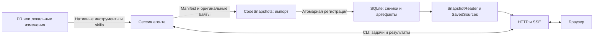

# Архитектура Devflow Diff Explain

## 1. Назначение и состав

Инструмент помогает человеку понять конкретную версию диффа: описание проблемы и решения → окружающая архитектура и поток данных → смысловые блоки → упорядоченные файлы с полными патчами → пояснения важных строк. Детали человек запрашивает в чате. Целевой UI — обычное окно браузера на компьютере.

| Пакет | Ответственность |
|---|---|
| `protocol` | Zod-схемы межпроцессных сообщений, задач, объяснения и сохранённых данных |
| `server` | HTTP/SSE, очередь, SQLite, чтение источников, генерация и чат |
| `ui` | Описание, схема, блоки, полный дифф файла, навигация и чат |
| `cli` | Discovery сервера, запуск и pull-петля воркера; standalone `.mjs` |
| `skill` | Инструкция агенту и сборка устанавливаемого комплекта |
| `fixtures` | Детерминированные примеры диффов и объяснений |
| `e2e` | Проверка собранного приложения в браузере |

Сервер не вызывает LLM самостоятельно. Модель работает в сессии агента, вызвавшей скилл. Установка — копия пяти файлов: `SKILL.md`, `agents/openai.yaml`, `version.json`, CLI и серверный бандл со встроенным UI. Метаданные задают короткое имя «Дифф — объяснить» и `policy.allow_implicit_invocation: false`; описание скилла также ограничивает запуск явным вызовом. Поставляемый скилл не содержит исходники монорепозитория и не связан с ними симлинком.

## 2. Поток данных

`CodeSnapshots` принимает только локальные manifests `code-snapshot/1` и `code-sources/1`. `codeSnapshotId` хэширует проект, ревизии, инвентарь, patch и хэши сторон с типами объектов; это идентичность кода, отдельная от `snapshotId` объяснения. Импорт сверяет patch с полными сторонами, наличие всех файлов инвентаря, пути и уникальность. Артефакт не выходит через traversal или symlink за экспортный каталог. SQLite хранит оригинальные BLOB по SHA-256; они не ограничены 256 КиБ результата агента. Видимый снимок, источники и патч регистрируются одной транзакцией. Повтор идентичен по содержимому; конфликт diffId/источника отклоняется.

Без провайдерского запроса приложение не доказывает, что список действительно покрывает весь PR или соответствует upstream: за нативный полный инвентарь отвечает экспортирующий агент. Отдельный full-read QA сравнивает его независимо. Приложение не выполняет команды из manifest, не получает URL и не содержит клиентов Arcanum/GitHub, VCS-процессов, auth discovery или polling. Fixtures экспортируются только dev/test helper и проходят тот же importer.

`SnapshotReader` читает сохранённые снимки, `IterationStore` хранит локальную историю патчей, `IterationFeed` сообщает о явном импорте версии. История и выбранный разбор не переключаются после push; приложение узнаёт новую версию только из импорта. Метаданные взяты из manifest, незнакомые значения не восстанавливаются через сеть. `PrMetaCache` обновляется на старте/импорте, без таймера повторов.

## 3. Подготовка объяснения

`RouteOrchestrator` обслуживает первоначальный обзор, продолжение файлов, адресные исправления и повтор схемы через `route.prepare`. Первому checkpoint нужен обзор с полным назначением файлов; одновременно можно сдать любое число пояснений вплоть до всех. Продолжение принимает `files`, `overview` либо `update` и сохраняет принятые материалы. Повтор схемы — тот же путь с требованием вернуть flow. Отдельного исполнителя схемы нет.

`checkpointEnvelopeSchema` проверяет структуру целиком; `explainedFileWorkerResultSchema` проверяет каждый файл независимо. Они выведены из той же схемы, которая выдаётся модели как JSON Schema. Старые worker-форматы/claims не принимаются новой сессией. Простые sources/limitation нормализуются приложением во внутренние evidence records. Невалидный граф/владение отклоняет весь структурный update; ошибка одного файла сохраняет независимые соседние файлы. Индексы владельцев, изменённых файлов и патчей строятся один раз на checkpoint. Частичная квитанция и ошибки исправлений сохраняются с документом.

`SavedSources` разрешает ссылки при сдаче результата только из импортированных байтов либо ранее сохранённых диапазонов. Его область `AsyncLocalStorage` изолирована по серверу. Полный текст источника хранится один раз, диапазон и его хэш получают отдельную стабильную ссылку. Недостающий структурный/чатовый источник отклоняет результат; ошибка в источнике файла относится только к этому файлу. Сначала агент импортирует необходимый источник, затем сдаёт ответ. Чтение HTTP никогда не ставит задачу модели. Старый кэш не пополняется обращением к провайдеру.

`validateArchitectureOverview` проверяет граф, block/node ID, одного основного владельца каждого изменённого файла и допустимые перекрёстные связи. Метаданные узлов наследуются из блоков, если агент не уточнил их явно; подписи окружения извлекает рендерер Mermaid. Несколько представлений могут использовать общие ID. `parseExplanationBlocks` поддерживает безопасный Markdown без произвольных стилевых требований. Проверки структуры не доказывают смысловую истинность объяснения модели.

Payload содержит intent, короткий target.json с идентичностью кода, всем инвентарём и указателями на полные патчи. Дополнительный общий diff ограничен 320 КиБ; полные патчи и оригиналы сохраняются без усечения. Агент сам выбирает чтение и нативные инструменты; обязательного worktree, полного перечитывания контекста или порядка исследования нет. Принятый большой материал имеет отдельный путь по хэшу содержимого. Для чата фиксируются вопрос, вложение, версия, объяснение и история; новая сессия может восстановить контекст самостоятельно.

Рабочий UI сразу рендерится на русском в Arcanum dark. Загрузка настроек не блокирует первый рендер. textSize сохраняется, generationLocale задаёт предпочтение ответа; прежний явный locale мигрирует в это предпочтение. Порядок выбора: запрос → generationLocale → язык worker → ru. Язык интерфейса не передаётся как приказ языку ответа.

Mermaid локально поставляется с UI, поддерживает ветви, группы, циклы и смену ориентации. Ошибка рендера сохраняется и допускает повтор через обычный checkpoint с сохранением файлов, связей и позиции. Старые v2–v6 и explanation/1 читаются; старые генераторы и стилевые валидаторы не исполняются. Новые блоки не получают фиктивные tier/anchors/tests/change; такие поля остаются только в читаемых прежних записях.

### Готовность материалов

Расчёт в `packages/protocol/src/preparation.ts` использует равные единицы: описание, схему, вводное пояснение каждого блока и пояснение каждого файла с принятыми аннотациями либо их явным отсутствием. После плана **N = 2 + B + F**, готовых единиц — K, процент — `floor(K / N × 100)`. Длина текста, число аннотаций и перекрёстные ссылки не меняют вес. До принятия плана знаменатель и процент неизвестны.

Готовая схема с неизвестными участками и обоснованная неприменимость дают единицу; ошибка и недоступный необходимый контекст — нет. Повторы и раунды контекста не меняют знаменатель. После полной готовности UI переносит «✓ Разбор готов» с раскрываемыми счётчиками в шапку, убирая отдельную строку прогресса; ответы чата остаются раскрытыми. Полный перезапуск создаёт новую подготовку; прежние материалы не входят в её K. Ошибка или отмена новой подготовки отражается в её статусе независимо от выбранного читаемого результата.

Для шести блоков и 29 файлов N = 37: описание даёт 1/37, вместе со схемой — 2/37, со всеми вводными блоков и 18 файлами — 26/37. Готовность всего, кроме схемы с ошибкой, — 36/37, 97% и частичный итог. Эти случаи закреплены в `packages/protocol/src/preparation.test.ts`.

## 4. Версия кода и навигация

`GuidedNavigation` — единый маршрут слева для обзора и непрерывного чтения; верхних вкладок и правого маршрута нет. Переход к описанию остаётся в панели во всех состояниях; отдельного списка и поиска «Все изменения» нет. Наведение и фокус заголовка связываются с подсветкой архитектуры через `App`. Смысловые заголовки отделены от `FileTree`. `buildFileTree` группирует соседние пути и сжимает одиночные цепочки каталогов, сохраняя принятый порядок файлов; возврат к прежнему каталогу может создать повторную ветку. Каталоги используют нативный `details`. В маршруте ими управляет `routeTreeReducer`: вход в другой блок и отдельный сигнал явного перехода раскрывают ветку, смена файла при прокрутке внутри блока не отменяет ручного сворачивания. «Развернуть всё» и «Свернуть всё» не меняют адрес чтения. Состояние живёт в компоненте, закреплённом за снимком; после нового открытия раскрыт только восстановленный блок. Статистика берётся из соответствующего `diffId`, число пояснений — из готового описания и аннотаций. `ReadFile` выводит статус и один путь, `DiffRows` по запросу показывает заголовки фрагментов из разобранной модели; это оформление не меняет патч, адресацию строк или протокол.

`GuidedDocument` постоянно выводит описание, архитектуру, все блоки и основные файлы одной лентой; метаданные PR находятся над ней. До плана `App` показывает каркас обзора и полные диффы. Нумерацию заголовков нормализует `numberedBlockTitle`: номер из ответа модели не дублирует номер маршрута. У `ReadFile` пояснение находится внутри карточки сразу после единственной шапки. Выбор в содержании прокручивает к маркеру блока или файла. `useGuideScroll` работает с первого открытия обзора и отмечает читаемый блок или файл без навигации, фокуса и изменения контекста чата. Весь холст, включая обзор, имеет одну область памяти `:canvas`; прежние области обзора и `:blocks` читаются при восстановлении старой позиции. Адрес строки и пояснения дополнен `fileId`, чтобы одинаковые номера строк разных файлов не сталкивались. Переход по ссылке к коду проверяет путь и сторону; файл при прокрутке не перемонтируется. Для возврата после адресного перехода сохраняется отдельная закладка положения и фокуса. Асинхронная отрисовка Mermaid перед изменением DOM вызывает общий `onLayout`, сохраняя положение читаемого фрагмента ниже схемы. Старые ссылки на код той же версии открывают общий холст; отдельный источник остаётся только для сохранённых прежних форматов или другой версии кода.

`ChatLauncher` показывает фиксированную кнопку снизу справа, скрывает её на время открытого чата и возвращает фокус после закрытия без прокрутки документа. `FloatingChat` задаёт фиксированную немодальную карточку поверх документа и не участвует в его колонках. Геометрия ограничивается окном и высотой закреплённой шапки; pointer capture используется только для перетаскивания свободной области заголовка. Локальное состояние карточки сохраняется при закрытии, а текст и вложение принадлежат `App`. `ChatPanel` отвечает за переписку и ввод, получает кнопки расширения через `headerActions`.

`useChatNotifications` ведёт локальные квитанции прочтения отдельно для каждого PR. Квитанция привязана к id обмена, задаче и ревизии ответа; максимального id недостаточно из-за повторов и разного порядка завершения. При первом чтении истории готовые ответы становятся исходной базой. Затем только показанные ответы в открытом чате видимой вкладки отмечаются прочитанными. Кнопка и панель используют один список обменов выбранной версии; прогресс выводится из состояния вопроса без вымышленного процента. Воркерский протокол и серверная история от локальных квитанций не зависят.

Объяснение и вопрос ссылаются на снимок, `diffId`, коммит и при необходимости файл, сторону и диапазон. `saved-patch-index.ts` разрешает ссылки только по сохранённым патчам этой версии; неоднозначный файл, отсутствующие или несмежные строки отклоняются. Живой checkout не подменяет старый дифф.

Полный патч файла берётся из импортированного снимка независимо от количества пояснений. При переходах UI сохраняет место чтения, раскрытые части и выделение; устаревший асинхронный ответ не должен менять уже выбранный файл. Без вложения вопрос получает весь рассказ и общий дифф выбранной версии независимо от открытой страницы. Явное вложение — файл (`ChatExplanation.file`) либо диапазон (`anchor`); одновременно оба запрещены. Файл проверяется по идентификатору и пути в сохранённом диффе; полный патч добавляется в общий hash-addressed payload без урезания, а пояснения остаются общим контекстом PR. До отправки могут достраиваться пояснения той же подготовки; при отправке UI берёт их из того же снимка, сохраняя версию кода и вложение. Отправленный вопрос и retry сохраняют принятый текст объяснения и вложение. Новая генерация не переписывает историю ответов.

Явное вложение черновика, выделение и полный текст его превью принадлежат `App` и сохраняются вместе с черновиком в `reader`. `ReadFile` и источники передают явное выделение без открытия чата. Удаление контекста очищает его и подсветку. Отдельная память подсветки переходов в `StoryData` не меняет контекст вопроса и не сохраняется между перезагрузками; прежние ключи выделений отдельных файлов больше не читаются. Короткая цитата входит в существующий `selectedText`, длинный диапазон передаётся через якорь и файлы контекста задачи без изменения воркерского протокола.

Локальная память чтения браузера не содержит токен доступа; состав сохраняемых полей проверяется схемами в `packages/ui/src/story/reading-cache.ts`.

## 5. Сервер, хранилище и восстановление

Сервер по умолчанию слушает `127.0.0.1` на случайном порту. Манифест `~/.sherpa/servers/<prKey>.json` содержит адрес, PID, токен и версии. Атомарное создание манифеста защищает от двух серверов одного PR. `/healthz` доступен без токена; API защищён bearer-токеном. SSE допускает токен в query, остальные ручки — только в заголовке.

Состояние PR находится в `~/.sherpa/prs/<prKey>`: SQLite в WAL, патчи итераций, payload задач и кэши. Внутренние имена пакетов — `@sherpa/*`. Миграции сохраняют пользовательские данные; обновление приложения не очищает БД и историю объяснений.

Очередь и привязки генерации переживают перезапуск. Документ/ответ, закрытие задачи, привязки и квитанция фиксируются в общей транзакции. Только память и уведомления публикуются после commit; ошибка одного уведомления не отменяет запись и не подавляет остальные. Перехваченное вложенное исключение помечает общую транзакцию как rollback-only. Сверка восстанавливает состояние после прерывания между этапами. Потерянная аренда возвращается в очередь по правилам протокола, а отменённый или чужой результат не заменяет актуальное объяснение.

Открытые задачи неподдерживаемого типа или эпохи задания отзываются при старте. Сохранённые снимки читаются через границу совместимости (`explanation-compat.ts`, `RouteStore`). Совместимость формата данных не означает возможность выполнения произвольных сохранённых задач.

## 6. Границы надёжности

Ошибка импорта, неимпортированный источник и отказ модели видимы как отдельные состояния. Схема независима от готовности основного объяснения. Новый импорт не меняет дифф уже начатой генерации: результат может стать устаревшим, что отмечается отдельно.

SSE передаёт состояние очереди и ревизии объяснения/чата; данные перечитываются REST-запросом. Остановка закрывает подписки, таймеры и ожидающие соединения до закрытия БД. Простой сервера и уход UI — разные механизмы; краткий обрыв SSE не считается завершением работы человека.

Автоматические проверки описаны в [testing.md](testing.md), pull-протокол и доступные ручки — в [protocol.md](protocol.md). Проверки формы и переходов дополняются ручной оценкой качества рассказа на реальном PR.

`generation_diff_id` сохраняет цель незавершённой подготовки отдельно от последнего импорта. Эпоха задания 8 отзывает старые аренды и перевыдаёт работу на том же diff. Принятые файлы v6 сохраняются. Недостающие legacy-байты ожидают явного импорта; удалять старые таблицы, пользовательский кэш и историю для миграции нельзя. Каталоги payload чистятся независимо от канонических артефактов, поэтому их удаление не ломает browser reading.

Контекст доказательств чата — детерминированная проекция сохранённых данных: одинаковый диапазон точной стороны выводится один раз с локальным ID, при этом каждый тезис/узел/ребро сохраняет ссылку на него. Mermaid не повторяется, если уже включён в зафиксированный текст объяснения. Legacy contexts, неизвестности и ограничения сохраняются; канонические источники и браузерное чтение не меняются. Реестр локален вопросу, разные стороны и файлы не объединяются по совпадению текста.
