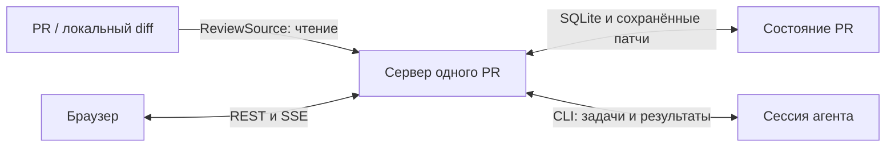

# Архитектура Devflow Diff Explain

## 1. Назначение и состав

Инструмент помогает человеку понять конкретную версию диффа: описание проблемы и решения → окружающая архитектура и поток данных → смысловые блоки → упорядоченные файлы с полными патчами → пояснения важных строк. Детали человек запрашивает в чате. Целевой UI — обычное окно браузера на компьютере.

| Пакет | Ответственность |
|---|---|
| `protocol` | Zod-схемы межпроцессных сообщений, задач, объяснения и сохранённых данных |
| `server` | HTTP/SSE, очередь, SQLite, чтение источников, генерация и чат |
| `ui` | Описание, схема, блоки, полный дифф файла, навигация и чат |
| `cli` | Discovery сервера, запуск и pull-петля воркера; standalone `.mjs` |
| `skill` | Инструкция агенту и сборка устанавливаемого комплекта |
| `fixtures` | Детерминированные примеры диффов и объяснений |
| `e2e` | Проверка собранного приложения в браузере |

Сервер не вызывает LLM самостоятельно. Модель работает в сессии агента, вызвавшей скилл. Установка — копия четырёх файлов: `SKILL.md`, `version.json`, CLI и серверный бандл со встроенным UI. Поставляемый скилл не содержит исходники монорепозитория и не связан с ними симлинком.

## 2. Поток данных

`server.ts` собирает один сервер на ключ PR. `ReviewSource` даёт метаданные, итерации, дифф и доступный контекст файлов. Производственный селектор возвращает фасад только с методами чтения. Полные адаптерные контракты за этой границей могут содержать методы записи; сервер объяснения их не получает и не подключает треды.

Рабочие сервисы:

- `RouteOrchestrator` фиксирует дифф, ставит план и заполнение блоков, проверяет результаты и восстанавливает незавершённую генерацию.
- `FlowCoordinator` строит схему отдельно: окружение изменения, потоки данных, отмеченные изменения и неизвестные связи. Сбой схемы не блокирует чтение файлов.
- `ChatOrchestrator` создаёт задачи по явным вопросам, сохраняет ответы и закреплённый контекст для повторов.
- `IterationFeed` следит за итерациями, сохраняет их патчи и отмечает устаревшее объяснение. Интердифф нужен для списка затронутых блоков.
- `TaskQueue`, `WorkerRegistry`, `UiPresence` управляют арендой задач, одной активной сессией воркера и присутствием браузера.

Публикация комментариев, вердикты, отметки ревью, исправление замечаний, отправка фидбека в Tracker и автоматическая проверка внешних обновлений не входят в приложение. Соответствующие HTTP-маршруты не регистрируются. Установленный скилл обновляется командой установки из репозитория.

## 3. Генерация объяснения

Контракт v6 использует две генерации. `route.skeleton` возвращает описание, Mermaid flowchart и блоки с готовыми вводными пояснениями, файлами и `nodeIds`. `route.section` получает весь оставшийся список файлов во всех блоках и возвращает только пояснения и аннотации. Обычно достаточно одной задачи каждого типа. Если ответ ограничен по объёму, приёмщик принимает только непрерывный префикс назначений; следующая задача с тем же промптом продолжает оставшиеся файлы. Готовые материалы не перезаписываются. Состав и порядок блоков не меняются. Для маленького PR действует тот же сценарий.

Метаданные текущей подготовки хранятся отдельно от читаемых снимков. UI сохраняет выбранный снимок, раздел, место чтения, выделение и черновик вопроса; новый план не переключает человека автоматически. Источники описания и схемы остаются в сохранённом контракте и контексте агента; соответствующие раскрытия не выводятся в UI.

Общие payload-файлы содержат методичку, метаданные PR, список файлов и пронумерованный дифф. Начальный контекст ограничен бюджетом 320 КиБ; полный список файлов сохраняется всегда. Отдельный индекс полных сохранённых патчей позволяет читать нужный файл без потери его версии. Метрика урезания хранится вместе с идентификатором снимка.

Рабочий UI фиксирован на русском и в Arcanum dark; прежние настройки оформления читаются для совместимости, но не меняют первый HTML и рабочий интерфейс.

Mermaid загружается локально из сборки UI и отрисовывает flowchart с ветвлениями, группами и циклами. UI по умолчанию задаёт вертикальное направление, позволяет переключить его локально и вписывает SVG в ширину контейнера. Сгенерированные цвета заменяются семантическими токенами приложения, включая SVG-стили с высокой специфичностью. Метаданные узлов задают влияние PR и источники; `nodeIds` связывают их с блоками без отношения 1:1. UI связывает выбор узла с переходом к блоку, а фокус блока — с подсветкой его узлов. Ошибка отрисовки отражается в сохранённой готовности схемы. Локальная `route.diagram` повторяет первый промпт с принятым обзором; сервер разрешает заменить только схему, сохраняя описание, связи блоков и файлы.

Сохранённые v2–v5 и незавершённые задания прежних форматов поддерживаются отдельно. Для старой схемы остаётся `FlowCoordinator`: ограниченные фрагменты окружающего кода читаются на закреплённой ревизии. Новый первый этап получает полный индекс сохранённых патчей; отсутствие подтверждённого контекста обозначается ограничением.

Результаты проходят схемы и предметные проверки в `architecture-story.ts`, `story.ts` и `diagram-sources.ts`: назначенные блоки, файлы, версия, сторона и диапазоны строк. Это проверяет структуру и существование доказательств, но не доказывает истинность каждого объяснения модели. Примеры в пояснениях — иллюстрации, если они не подтверждены выполненной проверкой.

### Готовность материалов

Расчёт в `packages/protocol/src/preparation.ts` использует равные единицы: описание, схему, вводное пояснение каждого блока и пояснение каждого файла с принятыми аннотациями либо их явным отсутствием. После плана **N = 2 + B + F**, готовых единиц — K, процент — `floor(K / N × 100)`. Длина текста, число аннотаций и перекрёстные ссылки не меняют вес. До принятия плана знаменатель и процент неизвестны.

Готовая схема с неизвестными участками и обоснованная неприменимость дают единицу; ошибка и недоступный необходимый контекст — нет. Повторы и раунды контекста не меняют знаменатель. После полной готовности UI сворачивает только панель подготовки в «✓ Разбор готов» с раскрываемыми счётчиками; ответы чата остаются раскрытыми. Полный перезапуск создаёт новую подготовку; прежние материалы не входят в её K. Ошибка или отмена новой подготовки отражается в её статусе независимо от выбранного читаемого результата.

Для шести блоков и 29 файлов N = 37: описание даёт 1/37, вместе со схемой — 2/37, со всеми вводными блоков и 18 файлами — 26/37. Готовность всего, кроме схемы с ошибкой, — 36/37, 97% и частичный итог. Эти случаи закреплены в `packages/protocol/src/preparation.test.ts`.

## 4. Версия кода и навигация

`GuidedDocument` выводит все блоки и основные файлы одной лентой; у `ReadFile` пояснение находится внутри карточки сразу после единственной шапки. Выбор в содержании прокручивает к маркеру блока или файла. `useGuideScroll` отмечает читаемый файл без навигации, фокуса и изменения контекста чата. Вся лента имеет одну область памяти `:blocks`; адрес строки и пояснения дополнен `fileId`, чтобы одинаковые номера строк разных файлов не сталкивались. Переход по ссылке к коду проверяет путь и сторону; файл при прокрутке не перемонтируется. Для возврата после адресного перехода сохраняется отдельная закладка положения и фокуса.

Объяснение и вопрос ссылаются на снимок, `diffId`, коммит и при необходимости файл, сторону и диапазон. `saved-patch-index.ts` разрешает ссылки только по сохранённым патчам этой версии; неоднозначный файл, отсутствующие или несмежные строки отклоняются. Живой checkout не подменяет старый дифф.

Полный патч файла берётся из PR независимо от количества пояснений. При переходах UI сохраняет место чтения, раскрытые части и выделение; устаревший асинхронный ответ не должен менять уже выбранный файл. Без вложения вопрос получает весь рассказ и общий дифф выбранной версии независимо от открытой страницы. Явное вложение — файл (`ChatExplanation.file`) либо диапазон (`anchor`); одновременно оба запрещены. Файл проверяется по идентификатору и пути в сохранённом диффе; полный патч добавляется в общий hash-addressed payload без урезания, а пояснения остаются общим контекстом PR. До отправки могут достраиваться пояснения той же подготовки; при отправке UI берёт их из того же снимка, сохраняя версию кода и вложение. Отправленный вопрос и retry сохраняют принятый текст объяснения и вложение. Новая генерация не переписывает историю ответов.

Явное вложение черновика, выделение и полный текст его превью принадлежат `App` и сохраняются вместе с черновиком в `reader`. `ReadFile` и источники передают явное выделение без открытия чата. Удаление контекста очищает его и подсветку. Отдельная память подсветки переходов в `StoryData` не меняет контекст вопроса и не сохраняется между перезагрузками; прежние ключи выделений отдельных файлов больше не читаются. Короткая цитата входит в существующий `selectedText`, длинный диапазон передаётся через якорь и файлы контекста задачи без изменения воркерского протокола.

Локальная память чтения браузера не содержит токен доступа; состав сохраняемых полей проверяется схемами в `packages/ui/src/story/reading-cache.ts`.

## 5. Сервер, хранилище и восстановление

Сервер по умолчанию слушает `127.0.0.1` на случайном порту. Манифест `~/.sherpa/servers/<prKey>.json` содержит адрес, PID, токен и версии. Атомарное создание манифеста защищает от двух серверов одного PR. `/healthz` доступен без токена; API защищён bearer-токеном. SSE допускает токен в query, остальные ручки — только в заголовке.

Состояние PR находится в `~/.sherpa/prs/<prKey>`: SQLite в WAL, патчи итераций, payload задач и кэши. Внутренние имена пакетов — `@sherpa/*`. Миграции сохраняют пользовательские данные; обновление приложения не очищает БД и историю объяснений.

Очередь и привязки генерации переживают перезапуск. Результат сначала проверяется, затем фиксируется; побочный эффект применяется после коммита. Сверка восстанавливает состояние после прерывания между этапами. Потерянная аренда возвращается в очередь по правилам протокола, а отменённый или чужой результат не заменяет актуальное объяснение.

Открытые задачи неподдерживаемого типа или эпохи задания отзываются при старте. Сохранённые снимки читаются через границу совместимости (`explanation-compat.ts`, `RouteStore`). Совместимость формата данных не означает возможность выполнения произвольных сохранённых задач.

## 6. Границы надёжности

Сетевой отказ источника, недоступный контекст и отказ модели видимы как отдельные состояния. Схема независима от готовности основного объяснения. Пуш не меняет дифф уже начатой генерации: результат может стать устаревшим, что отмечается отдельно.

SSE передаёт состояние очереди и ревизии объяснения/чата; данные перечитываются REST-запросом. Остановка закрывает подписки, таймеры и ожидающие соединения до закрытия БД. Простой сервера и уход UI — разные механизмы; краткий обрыв SSE не считается завершением работы человека.

Автоматические проверки описаны в [testing.md](testing.md), pull-протокол и доступные ручки — в [protocol.md](protocol.md). Проверки формы и переходов дополняются ручной оценкой качества рассказа на реальном PR.
