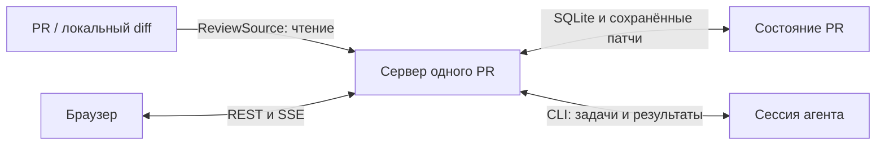

# Архитектура Devflow Diff Explain

## 1. Назначение и состав

Инструмент помогает человеку понять конкретную версию диффа: описание проблемы и решения → окружающая архитектура и поток данных → смысловые блоки → упорядоченные файлы с полными патчами → пояснения важных строк. Детали человек запрашивает в чате. Целевой UI — обычное окно браузера на компьютере.

| Пакет | Ответственность |
|---|---|
| `protocol` | Zod-схемы межпроцессных сообщений, задач, объяснения и сохранённых данных |
| `server` | HTTP/SSE, очередь, SQLite, чтение источников, генерация и чат |
| `ui` | Описание, схема, блоки, полный дифф файла, навигация и чат |
| `cli` | Discovery сервера, запуск и pull-петля воркера; standalone `.mjs` |
| `skill` | Инструкция агенту и сборка устанавливаемого комплекта |
| `fixtures` | Детерминированные примеры диффов и объяснений |
| `e2e` | Проверка собранного приложения в браузере |

Сервер не вызывает LLM самостоятельно. Модель работает в сессии агента, вызвавшей скилл. Установка — копия четырёх файлов: `SKILL.md`, `version.json`, CLI и серверный бандл со встроенным UI. Поставляемый скилл не содержит исходники монорепозитория и не связан с ними симлинком.

## 2. Поток данных

`server.ts` собирает один сервер на ключ PR. `ReviewSource` даёт метаданные, итерации, дифф и доступный контекст файлов. Производственный селектор возвращает фасад только с методами чтения. Реализации адаптеров и некоторые схемы ещё содержат прежние контракты ревью; сервер объяснения не получает их методы записи и не подключает треды.

Рабочие сервисы:

- `RouteOrchestrator` фиксирует дифф, ставит план и заполнение блоков, проверяет результаты и восстанавливает незавершённую генерацию.
- `FlowCoordinator` строит схему отдельно: окружение изменения, потоки данных, отмеченные изменения и неизвестные связи. Сбой схемы не блокирует чтение файлов.
- `ChatOrchestrator` создаёт задачи по явным вопросам, сохраняет ответы и закреплённый контекст для повторов.
- `IterationFeed` следит за итерациями, сохраняет их патчи и отмечает устаревшее объяснение. Интердифф нужен для списка затронутых блоков.
- `TaskQueue`, `WorkerRegistry`, `UiPresence` управляют арендой задач, одной активной сессией воркера и присутствием браузера.

Публикация комментариев, вердикты, буфер черновиков, перенос отметок ревью, раунды исправления замечаний, отправка фидбека в Tracker и проверка обновлений не запускаются. Их HTTP-маршруты не регистрируются. Обновление установленного скилла выполняется командой установки из репозитория.

## 3. Генерация объяснения

План (`route.skeleton`, контракт v5) задаёт самодостаточное описание и смысловые блоки с файлами в порядке понимания. Сначала подготавливается схема; её готовность, обоснованная неприменимость или явный отказ открывают подготовку подробностей. Задачи `route.section` заполняют до трёх назначенных файлов одного блока; первая часть также содержит вводное пояснение блока. Принятые части сохраняются независимо, готовые файлы соседних частей не перезаписываются. Для маленького PR действует тот же сценарий.

Метаданные текущей подготовки хранятся отдельно от читаемых снимков. Готовность — принятые единицы из `2 + число блоков + число файлов`: описание, схема, вводные блоков и пояснения файлов с аннотациями. Ошибка схемы не засчитывается, обоснованная неприменимость засчитывается. Повторы не меняют знаменатель. UI сохраняет выбранный снимок, страницу, место чтения, выделение и черновик вопроса; новый план не переключает человека автоматически. Источники описания ведут ссылками к полному сохранённому диффу.

Общие payload-файлы содержат методичку, метаданные PR, список файлов и пронумерованный дифф. Начальный контекст ограничен бюджетом 320 КиБ; полный список файлов сохраняется всегда. Отдельный индекс полных сохранённых патчей позволяет читать нужный файл без потери его версии. Метрика урезания хранится вместе с идентификатором снимка.

Схема (`route.diagram`) строится самостоятельной задачей. При необходимости агент запрашивает ограниченные диапазоны окружающего кода на закреплённой ревизии. Источник, версия, объём и таймаут проверяются сервером; недоступная связь остаётся неизвестной.

Результаты проходят схемы и предметные проверки в `story.ts` / `flow-coordinator.ts`: назначенные блоки, файлы, версия, сторона и диапазоны строк. Это проверяет структуру и существование доказательств, но не доказывает истинность каждого объяснения модели. Примеры в пояснениях — иллюстрации, если они не подтверждены выполненной проверкой.

## 4. Версия кода и навигация

Объяснение и вопрос ссылаются на снимок, `diffId`, коммит и при необходимости файл, сторону и диапазон. `saved-patch-index.ts` разрешает ссылки только по сохранённым патчам этой версии; неоднозначный файл, отсутствующие или несмежные строки отклоняются. Живой checkout не подменяет старый дифф.

Полный патч файла берётся из PR независимо от количества пояснений. При переходах UI сохраняет место чтения, раскрытые части и выделение; устаревший асинхронный ответ не должен менять уже выбранный файл. Вопрос и retry сохраняют исходный контекст объяснения. Новая генерация не переписывает историю ответов.

## 5. Сервер, хранилище и восстановление

Сервер по умолчанию слушает `127.0.0.1` на случайном порту. Манифест `~/.sherpa/servers/<prKey>.json` содержит адрес, PID, токен и версии. Атомарное создание манифеста защищает от двух серверов одного PR. `/healthz` доступен без токена; API защищён bearer-токеном. SSE допускает токен в query, остальные ручки — только в заголовке.

Состояние PR находится в `~/.sherpa/prs/<prKey>`: SQLite в WAL, патчи итераций, payload задач и кэши. Каталог `~/.sherpa` и внутренние имена `@sherpa/*` сохранены ради совместимости. Старые таблицы и миграции не удаляются из пользовательской БД.

Очередь и привязки генерации переживают перезапуск. Результат сначала проверяется, затем фиксируется; побочный эффект применяется после коммита. Сверка восстанавливает состояние после прерывания между этапами. Потерянная аренда возвращается в очередь по правилам протокола, а отменённый или чужой результат не заменяет актуальное объяснение.

Старые открытые задачи ревью отменяются при старте; устаревший формат незавершённой генерации не продолжается. Сохранённые снимки остаются читаемыми через границу совместимости (`explanation-compat.ts`, `RouteStore`). Совместимость данных не включает запуск старого сценария.

## 6. Границы надёжности

Сетевой отказ источника, недоступный контекст и отказ модели видимы как отдельные состояния. Схема независима от готовности основного объяснения. Пуш не меняет дифф уже начатой генерации: результат может стать устаревшим, что отмечается отдельно.

SSE передаёт состояние очереди и ревизии объяснения/чата; данные перечитываются REST-запросом. Остановка закрывает подписки, таймеры и ожидающие соединения до закрытия БД. Простой сервера и уход UI — разные механизмы; краткий обрыв SSE не считается завершением работы человека.

Автоматические проверки описаны в [testing.md](testing.md), pull-протокол и доступные ручки — в [protocol.md](protocol.md). Проверки формы и переходов дополняются ручной оценкой качества рассказа на реальном PR.
