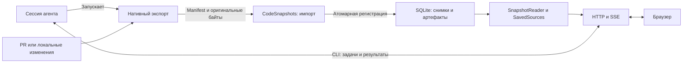

# Архитектура Devflow Diff Explain

## 1. Назначение и состав

Инструмент помогает человеку понять конкретную версию диффа: описание проблемы и решения → окружающая архитектура и поток данных → смысловые блоки → упорядоченные файлы с полными патчами → пояснения важных строк. Детали человек запрашивает в чате. Целевой UI — обычное окно браузера на компьютере.

| Пакет | Ответственность |
|---|---|
| `protocol` | Zod-схемы межпроцессных сообщений, задач, объяснения и сохранённых данных |
| `server` | HTTP/SSE, очередь, SQLite, чтение источников, генерация и чат |
| `ui` | Описание, схема, блоки, полный дифф файла, навигация и чат |
| `cli` | Discovery сервера, запуск и pull-петля воркера; standalone `.mjs` |
| `skill` | Инструкция агенту и сборка устанавливаемого комплекта |
| `fixtures` | Детерминированные примеры диффов и объяснений |
| `e2e` | Проверка собранного приложения в браузере |

Сервер не вызывает LLM самостоятельно. Модель работает в сессии агента, вызвавшей скилл. Комплект скилла содержит инструкцию, метаданные, версию, основной CLI, сервер со встроенным UI и отдельную команду экспорта Arc. Метаданные задают короткое имя «Дифф — объяснить» и `policy.allow_implicit_invocation: false`; описание скилла также ограничивает запуск явным вызовом. Поставляемый скилл не содержит исходники монорепозитория и не связан с ними симлинком.

## 2. Поток данных

`CodeSnapshots` принимает только локальные manifests `code-snapshot/1` и `code-sources/1`. Новые `codeSnapshotId` хэшируют проект, diffId, ревизии, инвентарь, patch и хэши сторон с типами объектов; уже выданные ID прежнего алгоритма сохраняются при точном повторном импорте. Это идентичность закреплённого кода, отдельная от `snapshotId` объяснения. Импорт сверяет patch с полными сторонами, наличие всех файлов инвентаря, пути и уникальность. Артефакт не выходит через traversal или symlink за экспортный каталог. Повтор одного файла/типа/режима в пределах импорта использует одни считанные и проверенные байты; следующий импорт читает экспорт заново. SQLite хранит оригинальные BLOB по SHA-256 вне лимита результата модели. Видимый снимок, источники и патч регистрируются одной транзакцией; конфликт diffId/источника отклоняется.

Для PR Arc роль экспортёра выполняет отдельная команда скилла. Она получает ID опубликованной итерации и её точные base/merge через установленный инструмент Arcanum, получает список изменений через `arc diff --name-status --json` между этими ревизиями и выгружает нужные пути каждой стороны командой `arc export`. Если Arc свернул перемещённый или скопированный каталог в одну запись, второй нативный список с `--resolve-moves=0` даёт полный набор файлов. Прежние пути берутся из `source.path` первого списка. При проверке `arc show` удалил из gzip последовательность `ESC[1m`. Выгрузка через `arc export` сохранила исходные байты. Экспортёр записывает локальный manifest со ссылками на выгруженные стороны. Основной CLI открывает этот manifest командой `up --snapshot`. Для других источников полный инвентарь предоставляет выбранный агентом нативный инструмент. Импортёр проверяет внутреннюю согласованность поставки, её полнота относительно upstream зависит от экспортёра. Отдельный full-read QA сравнивает его независимо. Приложение не выполняет команды из manifest, не получает URL и не содержит клиентов Arcanum/GitHub, VCS-процессов, auth discovery или polling. Fixtures экспортируются только dev/test helper и проходят тот же importer.

`SnapshotReader` читает сохранённые снимки, `IterationStore` хранит каталог версий: новые записи ссылаются на канонический `code_snapshots`, прежние полные `diff_json` остаются читаемыми. `IterationFeed` сообщает об явном импорте и для локальных снимков читает каталог напрямую, без синхронизации SQLite с собой через хост. История и выбранный разбор не переключаются после push. Метаданные берутся из manifest; `PrMetaCache` обновляется на старте/импорте без таймера.

При дополнении legacy-снимка сохраняются исторический patch, ID и координаты: конфликт отклоняет весь импорт. Миграция `030-code-artifact-aliases` сохраняет прежние непрозрачные `image.blobId` через таблицу соответствия проверенному SHA-256 артефакту. Импорт до регистрации сверяет MIME, стороны, размеры и прежние локальные байты; конфликт alias, канонического хэша или другого снимка откатывает вместе снимок, новые BLOB и источники. После перезапуска старый ID изображения разрешается из SQLite без каталога экспорта. Недостающий оригинал старой версии не читается из активного снимка, даже при совпавшей локальной метке ревизии. Повтор внешнего источника проверяет происхождение (URL, время и границы захвата) вместе с байтами, а не принимает первое происхождение молча.

## 3. Подготовка объяснения

`RouteOrchestrator` обслуживает первоначальный обзор, продолжение файлов, адресные исправления и повтор схемы через `route.prepare`. Первому checkpoint нужен обзор с полным назначением файлов; одновременно можно сдать любое число пояснений вплоть до всех. Продолжение принимает `files`, `overview` либо `update` и сохраняет принятые материалы. Повтор схемы — тот же путь с требованием вернуть flow. Отдельного исполнителя схемы нет.

`checkpointEnvelopeSchema` проверяет структуру целиком; `explainedFileWorkerResultSchema` проверяет каждый файл независимо. Схема writer и runtime имеют одинаковые взаимоисключения. Старые worker-форматы/claims не принимаются новой сессией. Простые sources/limitation нормализуются приложением во внутренние evidence records. Невалидная структура отклоняет всю смешанную сдачу: до принятия владельцев отдельные файлы не публикуются. На корректной структуре отсутствующий path, дубли и ошибка диапазона отклоняют соответствующие элементы, сохраняя независимые хорошие файлы. Исчерпание исправления одного файла не останавливает остальные; последняя принятая версия и адресный повтор сохраняются.

Новые разборы сохраняются как `explanation/2`: один упорядоченный массив блоков и отдельные пояснения файлов по устойчивым file ID. HTTP-проекция восстанавливает совместимые planIndex/stops/tourOrder; они не являются тремя независимыми порядками хранения. Перегруппировка меняет владельца файла, сохраняя его принятый текст, annotations и example. Пропущенное поле сохраняется; явная очистка действует по контракту. Структурное обновление проверяет ожидаемую редакцию.

`SavedSources` разрешает ссылки при сдаче результата только из импортированных байтов либо ранее сохранённых диапазонов. Его область `AsyncLocalStorage` изолирована по серверу. Полный текст источника хранится один раз, диапазон и его хэш получают отдельную стабильную ссылку. Недостающий структурный/чатовый источник отклоняет результат; ошибка в источнике файла относится только к этому файлу. Сначала агент импортирует необходимый источник, затем сдаёт ответ. Чтение HTTP никогда не ставит задачу модели. Старый кэш не пополняется обращением к провайдеру.

`validateArchitectureOverview` проверяет граф, block/node ID, одного основного владельца каждого изменённого файла и допустимые перекрёстные связи. `mermaid-topology.ts` использует настоящий парсер Mermaid 11.17.2 и FlowDB без DOM/Chromium; ID в подписи или комментарии не считается узлом. Узлы окружения, группы и подписи извлекаются приложением; агент передаёт только связи блоков и нужные уточнения. Рёбра можно помечать по ID, а при совпадении ID между видами — с viewIndex. Версия Mermaid в сервере и UI закреплена одинаково; при обновлении проверяется адаптер к опубликованному flowchart chunk. `parseExplanationBlocks` поддерживает безопасный Markdown; проверки ссылок не доказывают смысловую истинность текста.

Каждая задача, включая чат по строкам, содержит путь к target JSON с идентичностью кода, инвентарём и указателями на полные патчи/источники. Общий индекс кэшируется до форматирования по коду, каталогу источников и настройкам представления. Дополнительный общий diff ограничен 320 КиБ; полные патчи и оригиналы не усечены. Продолжение содержит короткий список оставшегося и ошибок; полный принятый разбор доступен отдельным неизменным файлом восстановления по редакции. Агент выбирает чтение и инструменты сам. Материализованные пути существуют; удалённый временный кэш восстанавливается из канона.

`review_revisions` адресует опубликованный смысл как `(reviewId, revision)`. Очередь и progress не создают редакцию текста; видимые пояснения, связи и ограничения создают. Браузер отправляет `explanationRef`, а до обзора — `codeRef`, без копии explanation.text. Сервер сохраняет показанное объяснение один раз в обмене, а идентичность кода и точный текст выбранной истории — в `question_input`; retry использует тот же вход. История не копирует объяснения предыдущих вопросов. Новый источник той же версии агент может явно импортировать, не меняя прежних ссылок. Legacy-вопрос остаётся видимым с честной отметкой недостающего контекста; при невосстановимом входе точный повтор недоступен. Текущая строка `route_snapshots` пока сохраняет также оперативные статусы и переписывается при их изменении; неизменные редакции от этого не размножаются.

Рабочий UI сразу рендерится на русском в Arcanum dark. Загрузка настроек не блокирует первый рендер. textSize сохраняется, generationLocale задаёт предпочтение ответа; прежний явный locale мигрирует в это предпочтение. Порядок выбора: запрос → generationLocale → язык worker → ru. Язык интерфейса не передаётся как приказ языку ответа.

Mermaid локально поставляется с UI и поддерживает ветви, группы, циклы и смену ориентации. Серверный ready означает принятую структуру; браузер отдельно показывает загрузку, результат и ошибку отрисовки. Отсутствие браузера не считается наблюдавшимся успехом или ошибкой. Только ошибка отправляется серверу с версией отчёта, hash диаграммы, видом, причиной и потерянным ID при наличии. Устаревший отчёт не меняет исправленную диаграмму того же разбора. Повтор использует обычный checkpoint и сохраняет готовые файлы/позицию. Читаются unversioned legacy, v2–v6, explanation/1 и explanation/2; прежние генераторы и стилевые валидаторы не исполняются.

### Готовность материалов

Расчёт в `packages/protocol/src/preparation.ts` использует равные единицы: описание, схему, вводное пояснение каждого блока и пояснение каждого файла с принятыми аннотациями либо их явным отсутствием. После плана **N = 2 + B + F**, готовых единиц — K, процент — `floor(K / N × 100)`. Длина текста, число аннотаций и перекрёстные ссылки не меняют вес. До принятия плана знаменатель и процент неизвестны.

Готовая схема с неизвестными участками и обоснованная неприменимость дают единицу; ошибка и недоступный необходимый контекст — нет. Повторы и раунды контекста не меняют знаменатель. После полной готовности UI переносит «✓ Разбор готов» с раскрываемыми счётчиками в шапку, убирая отдельную строку прогресса; ответы чата остаются раскрытыми. Полный перезапуск создаёт новую подготовку; прежние материалы не входят в её K. Ошибка или отмена новой подготовки отражается в её статусе независимо от выбранного читаемого результата.

Для шести блоков и 29 файлов N = 37: описание даёт 1/37, вместе со схемой — 2/37, со всеми вводными блоков и 18 файлами — 26/37. Готовность всего, кроме схемы с ошибкой, — 36/37, 97% и частичный итог. Эти случаи закреплены в `packages/protocol/src/preparation.test.ts`.

## 4. Версия кода и навигация

Постоянная ссылка включает `code=<codeSnapshotId>` и при необходимости `review=<snapshotId>`. Код адресуется до первого обзора; при появлении пояснений страница принимает только разбор этого кода. Закреплённый разбор получает свои последующие checkpoint, а импорт B не подменяет A. GET diff/route умеют точный codeSnapshotId, независимо от активной версии и браузерного кэша. После перезапуска CLI разрешает тот же locator в новый URL: порт и токен экземпляра могут измениться.

`GuidedNavigation` — единый маршрут слева для обзора и непрерывного чтения; верхних вкладок и правого маршрута нет. Переход к описанию остаётся в панели во всех состояниях; отдельного списка и поиска «Все изменения» нет. Наведение и фокус заголовка связываются с подсветкой архитектуры через `App`. Смысловые заголовки отделены от `FileTree`. `buildFileTree` группирует соседние пути и сжимает одиночные цепочки каталогов, сохраняя принятый порядок файлов; возврат к прежнему каталогу может создать повторную ветку. Каталоги используют нативный `details`. В маршруте ими управляет `routeTreeReducer`: вход в другой блок и отдельный сигнал явного перехода раскрывают ветку, смена файла при прокрутке внутри блока не отменяет ручного сворачивания. «Развернуть всё» и «Свернуть всё» не меняют адрес чтения. Состояние живёт в компоненте, закреплённом за снимком; после нового открытия раскрыт только восстановленный блок. Статистика берётся из соответствующего `diffId`, число пояснений — из готового описания и аннотаций. `ReadFile` выводит статус и один путь, `DiffRows` по запросу показывает заголовки фрагментов из разобранной модели; это оформление не меняет патч, адресацию строк или протокол.

`GuidedDocument` постоянно выводит описание, архитектуру, все блоки и основные файлы одной лентой; метаданные PR находятся над ней. До плана `App` показывает каркас обзора и полные диффы. Нумерацию заголовков нормализует `numberedBlockTitle`: номер из ответа модели не дублирует номер маршрута. У `ReadFile` пояснение находится внутри карточки сразу после единственной шапки. Выбор в содержании прокручивает к маркеру блока или файла. `useGuideScroll` работает с первого открытия обзора и отмечает читаемый блок или файл без навигации, фокуса и изменения контекста чата. Весь холст, включая обзор, имеет одну область памяти `:canvas`; прежние области обзора и `:blocks` читаются при восстановлении старой позиции. Адрес строки и пояснения дополнен `fileId`, чтобы одинаковые номера строк разных файлов не сталкивались. Переход по ссылке к коду проверяет путь и сторону; файл при прокрутке не перемонтируется. Для возврата после адресного перехода сохраняется отдельная закладка положения и фокуса. Асинхронная отрисовка Mermaid перед изменением DOM вызывает общий `onLayout`, сохраняя положение читаемого фрагмента ниже схемы. Старые ссылки на код той же версии открывают общий холст; отдельный источник остаётся только для сохранённых прежних форматов или другой версии кода.

`ChatLauncher` показывает фиксированную кнопку снизу справа, скрывает её на время открытого чата и возвращает фокус после закрытия без прокрутки документа. `FloatingChat` задаёт фиксированную немодальную карточку поверх документа и не участвует в его колонках. Геометрия ограничивается окном и высотой закреплённой шапки; pointer capture используется только для перетаскивания свободной области заголовка. Локальное состояние карточки сохраняется при закрытии, а текст и вложение принадлежат `App`. `ChatPanel` отвечает за переписку и ввод, получает кнопки расширения через `headerActions`.

`useChatNotifications` ведёт локальные квитанции прочтения отдельно для каждого PR. Квитанция привязана к id обмена, задаче и ревизии ответа; максимального id недостаточно из-за повторов и разного порядка завершения. При первом чтении истории готовые ответы становятся исходной базой. Затем только показанные ответы в открытом чате видимой вкладки отмечаются прочитанными. Кнопка и панель используют один список обменов выбранной версии; прогресс выводится из состояния вопроса без вымышленного процента. Воркерский протокол и серверная история от локальных квитанций не зависят.

Объяснение и вопрос ссылаются на снимок, `diffId`, коммит и при необходимости файл, сторону и диапазон. `saved-patch-index.ts` разрешает ссылки только по сохранённым патчам этой версии; неоднозначный файл, отсутствующие или несмежные строки отклоняются. Живой checkout не подменяет старый дифф.

Полный патч файла берётся из импортированного снимка независимо от количества пояснений. Переходы сохраняют место чтения, раскрытия и выделение; запоздавший ответ не меняет выбранный файл. Вопрос без вложения относится ко всему закреплённому PR независимо от открытой страницы. Явное вложение — файл либо диапазон; вместе они запрещены. До отправки сервер проверяет совпадение file ID, пути, стороны и диапазона с полными байтами той же версии. Патч вложенного файла не урезается, пояснения остаются общим контекстом. При отправке UI указывает показанную редакцию, сервер фиксирует её текст, evidence, вложение и историю. Retry не пересобирает этот вход из нового состояния.

Явное вложение черновика, выделение и полный текст его превью принадлежат `App` и сохраняются вместе с черновиком в `reader`. `ReadFile` и источники передают явное выделение без открытия чата. Удаление контекста очищает его и подсветку. Отдельная память подсветки переходов в `StoryData` не меняет контекст вопроса и не сохраняется между перезагрузками; прежние ключи выделений отдельных файлов больше не читаются. Короткая цитата входит в существующий `selectedText`, длинный диапазон передаётся через якорь и файлы контекста задачи без изменения воркерского протокола.

Память чтения использует sessionStorage с областью вкладки и locator; токен доступа в ней не хранится. Состав полей проверяется схемами в `packages/ui/src/story/reading-cache.ts`. Источники обзора, блоков, примеров и схемы доступны через общий компонент; существенные ограничения видны рядом с текстом.

## 5. Сервер, хранилище и восстановление

Сервер по умолчанию слушает `127.0.0.1` на случайном порту. Манифест `~/.sherpa/servers/<prKey>.json` содержит адрес, PID, токен и версии. Атомарное создание манифеста защищает от двух серверов одного PR. `/healthz` доступен без токена; API защищён bearer-токеном. SSE допускает токен в query, остальные ручки — только в заголовке.

Состояние PR находится в `~/.sherpa/prs/<prKey>`: SQLite в WAL, патчи итераций, payload задач и кэши. Внутренние имена пакетов — `@sherpa/*`. Миграции сохраняют пользовательские данные; обновление приложения не очищает БД и историю объяснений.

Очередь и привязки генерации переживают перезапуск. Каждая выдача имеет собственный grantToken; CLI автоматически связывает его с неизменным `--lease` reference в готовых командах. Старые complete/progress/fail не получают токен новой выдачи тому же worker. Документ/ответ, закрытие задачи, привязки и повторяемая квитанция фиксируются одной транзакцией. Память, ревизии и уведомления публикуются после commit. Перехваченное вложенное исключение помечает транзакцию как rollback-only; отменённый или чужой результат не заменяет актуальный.

Открытые задачи неподдерживаемого типа или эпохи задания отзываются при старте. Сохранённые снимки читаются через границу совместимости (`explanation-compat.ts`, `RouteStore`). Совместимость формата данных не означает возможность выполнения произвольных сохранённых задач.

## 6. Границы надёжности

Ошибка импорта, неимпортированный источник и отказ модели видимы как отдельные состояния. Схема независима от готовности основного объяснения. Новый импорт не меняет дифф уже начатой генерации: результат может стать устаревшим, что отмечается отдельно.

SSE передаёт состояние очереди и ревизии объяснения/чата; данные перечитываются REST-запросом. Остановка закрывает подписки, таймеры и ожидающие соединения до закрытия БД. Простой сервера и уход UI — разные механизмы; краткий обрыв SSE не считается завершением работы человека.

Автоматические проверки описаны в [testing.md](testing.md), pull-протокол и доступные ручки — в [protocol.md](protocol.md). Проверки формы и переходов дополняются ручной оценкой качества рассказа на реальном PR.

`generation_diff_id` сохраняет цель подготовки отдельно от последнего импорта. Эпоха задания 9 отзывает прежнюю работу и перевыдаёт её на том же diff, сохраняя принятые файлы. Пустой diff имеет завершаемое состояние без бесконечной подготовки. Недостающие legacy-байты ожидают явного импорта; старые таблицы, ID и история не удаляются. Неизвестная более новая схема БД отклоняется до WAL/миграций. Payload чистится независимо от канонических артефактов.

Контекст доказательств чата — детерминированная проекция сохранённых данных: одинаковый диапазон точной стороны выводится один раз с локальным ID, при этом каждый тезис/узел/ребро сохраняет ссылку на него. Mermaid не повторяется, если уже включён в зафиксированный текст объяснения. Legacy contexts, неизвестности и ограничения сохраняются; канонические источники и браузерное чтение не меняются. Реестр локален вопросу, разные стороны и файлы не объединяются по совпадению текста.
