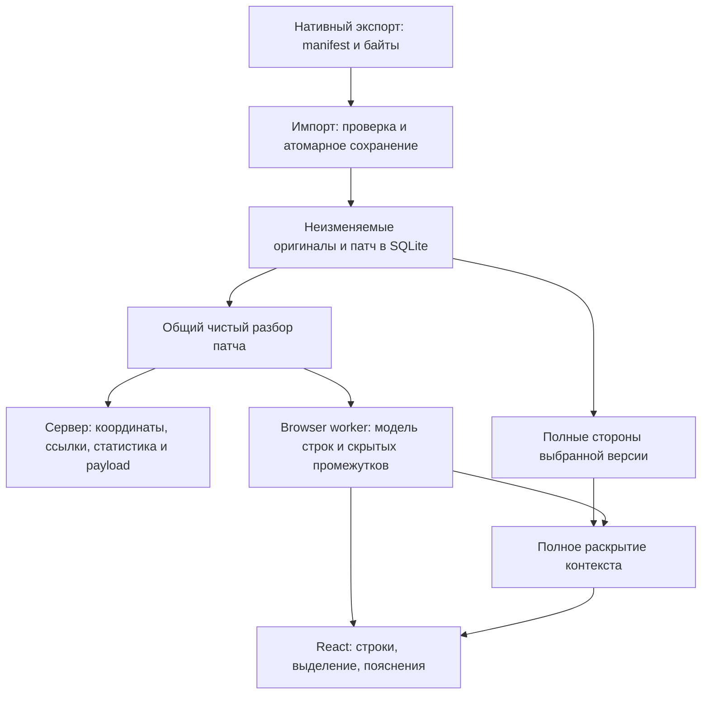

# План упрощения разбора и отображения диффа

Предложение к реализации, 7 ноября 2026 года. Основание — текущий код `2cde759`, [спецификация](spec.md), [архитектура](architecture.md), правила `AGENTS.md` и повторный разбор `diff-review` 1.0.0 из [SkillStore](https://skillstore.yandex-team.ru/skills/diff-review). Этот документ описывает будущие изменения, не заменяет действующие требования и не подтверждает выполненную реализацию.

**Состояние реализации:** общий парсер, безопасное оформление и полное раскрытие внедрены в рабочее дерево. Дополнительно исправлены обнаруженные при проверке координаты контекста нулевых диапазонов и показ старой модели при смене версии в том же компоненте. Действующее устройство описано в `architecture.md`, проверки — в `testing.md`; результаты приёмки находятся в игнорируемом `qa/diff-rendering-20261107/`. Коммит и установка дистрибутива этим этапом не выполняются.

## Цель и границы

Сократить число независимых трактовок патча и неиспользуемых состояний UI. Ошибки оформления не должны мешать чтению кода, а номера строк на экране, в задании агенту и в проверке ссылок должны совпадать.

Объём: общий разбор строк и координат; безопасная необязательная подсветка; упрощение раскрытия контекста до реально используемого полного раскрытия файла. Сохраняются все изменённые файлы, полные диффы и оригиналы, привязки пояснений, выделение сторон и диапазонов, переходы и чтение сохранённого без агента. Новые функции ревью, поиск, сравнение итераций и изменение пользовательского режима отображения в этот план не входят.

Экспортёр Arc, manifest, SQLite, идентичность кода, HTTP API, формат заданий и инструкции агенту остаются прежними. Агент не получает новых обязанностей или проверок. Работа со снимком уже выполняется скриптом; ради отображения не нужно передавать исходники через модель.

## Подтверждённые основания

| Сейчас | Следствие | Источник |
|---|---|---|
| Серверный `walkPatch` и UI `readHunk` независимо разбирают заголовки и считают стороны | Две реализации нужно синхронизировать; UI удаляет пустой хвост `split`, сервер при усечённом ханке может счесть его контекстом | `packages/server/src/route/diff-index.ts`, `packages/ui/src/diff/parse.ts` |
| Серверный обход используется не только валидатором, но и импортом, индексом сохранённых строк, статистикой и payload | Менять одну UI-функцию недостаточно: договор о координатах общий для всего пути | `code-snapshots.ts`, `saved-patch.ts`, `route-payload.ts`, `chat-payload.ts` в `packages/server/src` |
| `lowlight.highlight` и преобразование токенов не имеют локального fallback | Исключение оформления может сорвать разбор файла в worker или раскрытие оригинала | `packages/ui/src/diff/syntax.ts`, `diff/parse.ts`, `diff-view/expand.ts` |
| Единственный рабочий вызов `DiffRows` передаёт `contextAvailable={false}`, `content={null}`, без обработчиков раскрытия | Направления, ожидание и повтор для отдельных промежутков не используются текущим экраном | `packages/ui/src/story/read-file.tsx`, `diff-view/diff-rows.tsx` |
| Активны только полное раскрытие кнопкой и раскрытие для перехода к скрытым строкам | Карта состояний каждого промежутка избыточна для текущего поведения | `packages/ui/src/story/read-file.tsx`, `diff-view/expand.ts` |
| Кнопка раскрытия использует `.then(success, failure)`, а общий retry повторяет эффект чтения | Исключение внутри преобразования не попадает в этот failure; повтор не всегда повторяет загрузку контекста | `packages/ui/src/story/read-file.tsx` |

Это результаты статического исследования. Падение подсветки в реальном PR не воспроизводилось; для него нужно контролируемое внедрение ошибки в тесте. Расхождение на повреждённом патче не означает, что корректный импортированный снимок сейчас показывает неверные координаты.

У аналога полезны один общий парсер и отношение к подсветке как к необязательному оформлению. Его `parser.py` игнорирует маркер отсутствия перевода строки, а дополнительный контекст получается через VCS diff с `context=1_000_000`. Такая схема не обеспечивает наши полные автономные оригиналы. Построение второго представления из уже созданного DOM также не даёт преимуществ перед нашей моделью данных. Код аналога не копируется и не становится зависимостью.

## Целевая архитектура

На схеме один алгоритм разбора, а не единый сетевой сервис. Сервер и browser worker вызывают одну реализацию локально. Подсветка обогащает UI-модель и раскрытые строки; не влияет на наличие текста или координат. Проверки соответствия патча оригиналам остаются на границе импорта.

### 1. Общий разбор патча

Разместить независимый от окружения модуль в `packages/protocol/src/diff/` и предоставить отдельный экспорт `@sherpa/protocol/diff`. В пакете уже есть аналогичный subpath `./markdown`. Новый пакет, зависимости, DOM, Node API, React, библиотека подсветки и Zod-валидация каждой строки не нужны.

Предлагаемый контракт — `parseUnifiedPatch(patch: string)`, возвращающий упорядоченные части: строки вне ханков и ханки. Ханк содержит исходный заголовок, начальные номера, заявленные и фактические количества строк, строки тела и признак некорректности. Строка тела содержит исходный текст патча, вид, текст кода, номера обеих сторон; служебные маркеры не получают координат. Признак отсутствия перевода строки относится к предшествующей строке кода. Точные имена внутренних типов оставлены исполнителю.

Обязательная семантика:

- Только `\n` разделяет строки патча; `\r` в содержимом не удаляется. Завершающий разделитель не создаёт дополнительную строку. Настоящая пустая строка тела сохраняется.
- У добавления нет старого номера, у удаления — нового; контекст сдвигает обе стороны. Заголовки и служебные маркеры номера не сдвигают.
- Короткий заголовок без количества означает одну строку; нулевые диапазоны обрабатываются явно. Строки кода, начинающиеся с `---`, `+++` или `@@`, не становятся метаданными после снятия своего префикса.
- Тело заканчивается при исчерпании обоих заявленных счётчиков: следующий `+лишний хвост` не становится изменённой строкой. Следующий заголовок ханка, сырой `diff --git ` или конец патча обрывает недобранный ханк. Счётчики и некорректные префиксы диагностируются; отсутствующие строки не синтезируются.
- Для чтения прежних данных сохранить текущую UI-трактовку пустой строки тела и неизвестного префикса: текст неизвестной строки не теряется, она помечается некорректной. Фактические количества выводятся из тела. Служебные EOF-маркеры сохраняются и после последней строки ханка.
- Исходный patch не нормализуется и не переписывается. Внеханковые строки нужны серверному форматированию payload и UI-разбору метаданных.

Серверный `walkPatch` становится тонким адаптером над общим результатом: выдаёт прежние `raw/old/new/changed`. Он больше не содержит собственных регулярных выражений и счётчиков ханка. Для корректных патчей сохраняются координаты, порядок и текст numbered payload; завершающий перевод строки форматируется отдельно и не получает координат. Все нынешние потребители используют адаптер без массовой смены API.

UI `parse.ts` переводит общий результат в `DiffFileModel`: добавляет gaps, статистику, признаки whitespace-only, метаданные режима и бинарности, затем выделение слов и синтаксические токены. UI не считает координаты повторно и не меняет их при оформлении. Общие типы не содержат `tokens`, `words`, состояния раскрытия и React-ключей.

Наличие единого парсера не превращает прочитанный patch в доверенные данные. На импорте сохраняются `diff/createTwoFilesPatch`, `parsePatch`, `applyPatch` и точная сверка координат с полными сторонами. Библиотечное применение патча и собственная проверка координат решают разные задачи; первое может допускать поиск совпадения рядом с указанной строкой. Новый общий `malformed` сам по себе не становится дополнительным blanket-запретом всех исторически принимавшихся форматов: сохраняется существующая проверка содержимого и координат, изменения допуска подтверждаются отдельными тестами.

### 2. Оформление не блокирует чтение

В `syntax.ts` установить одну безопасную границу для лексера и преобразования результата в токены. При неизвестном языке или исключении возвращаются пустые токены для каждой исходной строки. Результат готовится до публикации: наружу не попадает частично заполненная разметка. Текст, номера и маркеры не меняются. Существующие ограничения размера подсветки сохраняются.

Оба потребителя — первоначальный разбор в worker и раскрытие оригинала — используют этот путь. Для выделения изменений внутри строки также отделить вычисление от структурного разбора: ошибка локального обогащения оставляет пару строк без `words`. Не оборачивать импорт, получение оригиналов и весь renderer в молчаливый catch: реальные ошибки материала должны оставаться видимыми.

Worker и его существующий механизм ответа/восстановления сохраняются. Не вводить фоновую очередь подсветки, повтор лексера или новый статус задачи для агента. Fallback означает обычный читаемый код и сохраняет фон добавленных/удалённых строк, выделение и ссылки.

### 3. Одно полное раскрытие файла

Упростить `expandFileContext` до чистого преобразования `(model, content) → model`: заполнить все скрытые промежутки из сохранённых сторон той же версии. Оба текущих вызова в `ReadFile` используют его напрямую. Карта `FileExpansion`, `expandAllGaps`, направления и количества шагов больше не нужны.

Сохранить используемую математику координат между ханками, поддержку начала/конца файла, объединение раскрытого контекста, отсутствие выдуманной строки после завершающего `\n`, неизменность исходной модели и идемпотентность повторного полного раскрытия. Добавленные/удалённые файлы уже содержат все строки патча. Бинарные и `content.kind === 'none'` сохраняют нынешнее поведение и доступ к оригиналам; новый просмотр metadata-only файла здесь не проектируется.

В `DiffRows` оставить пассивное обозначение скрытого промежутка. Удалить неиспользуемые callbacks и состояние частичного раскрытия, таймеры, направления, счётчики результатов и `context-expansion.ts`, если после переноса не останется потребителей. После удаления частичного преобразования удалить связанные `hiddenChanged`, `sourceKey`, `sourceGapKey` и функции подсчёта остатков. До удаления проверить ссылки во всём UI, включая тесты и галерею. Сам тип gap, координаты, обозначение неизвестной длины хвоста и стабильные ключи видимых строк сохраняются. Режим split и его парность не относятся к этому удалению.

На уровне `ReadFile` объединить fetch → преобразование → публикацию в локальную асинхронную операцию с перехватом ошибок всех трёх стадий. Успех публикует целую модель. Ошибка оставляет уже читаемые строки и предлагает повторить именно загрузку/раскрытие; retry парсинга не подменяет retry оригинала. Скачивание оригинала повторяется своей кнопкой и не маскируется retry парсинга. Поздний результат не меняет другой выбранный файл или версию; актуальность проверяется до публикации как в локальный state, так и в `StoryData`. Использовать существующее хранение модели и небольшой локальный guard операции; общего нового автомата запросов или переписывания кэшей не требуется. Недостающие оригиналы legacy-снимка не заменяются живым checkout либо активной версией.

## Выбор среди альтернатив

| Решение | Альтернатива | Почему выбран этот вариант |
|---|---|---|
| Общий чистый модуль с тонкими адаптерами | Два парсера и тесты равенства | Тесты нужны для перехода, но не устраняют необходимость синхронно менять две реализации |
| Сохранить библиотечную генерацию и применение патча | Написать собственный полный diff engine | Это увеличит ответственность кода без пользы для текущего упрощения |
| Разбирать локально одной реализацией | Хранить AST в БД или передавать новую модель через HTTP | Потребовались бы новые контракты, совместимость и инвалидация; выигрыш не измерен |
| Сохранить worker | Парсить и подсвечивать всё в основном потоке | Удаление транспорта не оправдывает риск блокировки интерфейса на большом файле |
| Только полное раскрытие в текущем экране | Сохранить либо включить направленное раскрытие | Сейчас потребителя нет; включение было бы новой продуктовой функцией |
| Сохранённые полные стороны | Дочитывание из VCS, как у аналога | Последнее нарушает требование автономного чтения закреплённой версии |

## Последовательность реализации

1. **Безопасное оформление — минимальный полезный результат.** Изменить `syntax.ts` и локальную границу word-diff; тестом внедрить исключение лексера и доказать чтение исходного патча и раскрытого контекста. Без смены API и поведения успешной подсветки. Это приращение можно принять отдельно.
2. **Упростить полное раскрытие.** Заменить карту расширений прямым преобразованием, перевести оба вызова `ReadFile`, исправить локальный retry, затем удалить неподключённые контролы и поля. Перенести содержательные тесты полного раскрытия; удалить тесты удалённых направлений и «чужих остановок». Проверить галерею и браузерный путь с восстановлением позиции.
3. **Объединить координатный разбор.** Сначала зафиксировать корпус ожидаемых строк и координат. Добавить общий модуль, переключить серверный адаптер и UI в одном законченном изменении, удалить дублирующий разбор. Обновить только относящиеся к нему комментарии и технические справочники. Не оставлять два рабочих алгоритма за флагом.
4. **Принять собранный результат.** Выполнить полные проверки, открыть сохранённый реальный снимок из отдельной копии БД без агента/экспорта/VCS, проверить старые ссылки, оригиналы, раскрытие и выделение. Перенести окончательное устройство в `architecture.md`, сценарии в `testing.md`. Не менять продуктовую спеку под детали рефакторинга.

Шаги 2 и 3 концептуально независимы, но затрагивают общую UI-модель; выполнять последовательно, чтобы упростить проверку промежуточных состояний. Каждый шаг оставляет читаемый рабочий продукт. Изменений схемы БД, миграции снимков и версии протокола не ожидается. Установка скилла, выпуск и коммит выполняются в рамках соответствующего запроса; этот план их не выполняет.

## Проверка требований и рисков

| Гарантия | Проверка, различающая правильную и ошибочную реализацию |
|---|---|
| Номера на экране, в payload и ссылках совпадают | Общий корпус с заранее заданными координатами для add/delete/context, нескольких ханков, коротких и нулевых диапазонов; сравнить UI, `walkPatch`, `savedPatchIndex` и numbered payload. Простого сравнения двух вызовов одной функции недостаточно |
| Текст и EOF не искажаются | Пустые строки, `\n` в конце и его отсутствие, EOF-маркеры обеих сторон, CRLF, Unicode, табы, строки кода с префиксами заголовков; сравнить ожидаемые строки и исходные байты оригиналов |
| Некорректный материал не создаёт ложных ссылок | Усечённый ханк с завершающим `\n`, следующий заголовок раньше счётчика, неизвестный префикс; никакой фиктивной последней строки. Сохранить отдельный тест отказа импорта для смещённых координат, даже когда `applyPatch` находит текст рядом |
| Совместимое чтение и допуск не ужесточаются незаметно | Сохранённый повреждённый legacy patch читается без исключения и переписывания байтов/ID; неизвестная строка остаётся видимой, конечный разделитель не получает координату. Отдельно закрепить ранее принимаемый библиотекой случай несовпадения counts с телом — нормализацию пустого блока — чтобы `malformed` не стал автоматическим запретом импорта |
| Сбой оформления не закрывает код | Лексер и word-diff принудительно бросают; текст, стороны, EOF, выделение и аннотации остаются. Проверить первоначальную модель и раскрытый контекст, отсутствие частичных токенов |
| Раскрытие не теряет строки и позицию | Начало/внутренний промежуток/хвост, разные сдвиги old/new, повторное раскрытие, add/delete; кнопка и переход по ссылке приводят к одинаковым строкам. Существующие изменённые строки и их ключи сохраняются |
| Ошибка сохраняет готовое и повторяет нужное действие | Первый запрос оригинала падает, следующий успешен; модель до успеха остаётся на экране, retry действительно снова получает оригинал. Поздний ответ A после перехода к B не меняет B или вложение вопроса |
| Версия и автономность сохраняются | Снимок A после импорта B и restart; экспорт удалён, агент и VCS недоступны. Сверить старую ссылку, строки и скачанные оригиналы; новый снимок самопроизвольно не выбирается |
| Удалённая сложность действительно ушла | Поиск потребителей и типов: нет отдельного счётчика ханков в UI/сервере, карты частичных раскрытий и неиспользуемых callbacks; тесты не удерживают мёртвый механизм |

Использовать существующие suites `diff/parse`, `diff/syntax`, `diff-view/expand`, `diff-view/diff-rows`, `diff-view/selection`, `route/diff-index`, `saved-patch`, `code-snapshots`, payload; добавить локальный DOM-тест `ReadFile` на ошибки и повтор. Общий корпус и его ожидаемые координаты разместить рядом с новым модулем, интеграционные проверки оставить у потребителей. Для раскрытия брать согласованные before/after и patch: нынешний искусственный `CONTENT` в `expand.test.ts` не подходит как доказательство совпадения текста сторон. Не переносить UI-тесты подсветки в общий пакет.

В E2E использовать действующие сценарии `story-reading`, `readable-story`, `acceptance-permalink`, `acceptance-frozen-question`. `guided-story.spec.ts` уже раскрывает файл, выделяет строки и проверяет возврат к позиции: усилить его проверкой точного текста скрытой строки, добавить ошибку и повтор загрузки без дублирования всего сценария. Ошибку внутреннего лексера проверять модульным тестом, без production-ручки внедрения ошибок. Галерея уже использует `ReadFile`; обновить соответствующие состояния и добавить карточку локальной ошибки раскрытия с повтором: существующее состояние ошибки внешнего источника её не заменяет.

Перед коммитами обязательны `pnpm -r typecheck`, `pnpm -r lint`, `pnpm -r test`. После изменений этих серверных/UI-потоков — `pnpm test:e2e` по `docs/testing.md`, с Chromium Headless Shell; сборки и E2E не запускать одновременно. Standalone-проверка должна подтвердить, что общий subpath попал в бандлы и не требует исходного репозитория. Имеющиеся сторонние правки `CONTRIBUTING.md`, `packages/e2e/README.md`, `packages/e2e/playwright.config.ts` не включать в реализацию этого плана.

На существующем большом fixture сравнить время разбора, раскрытия и отзывчивость до/после на одной среде. Общий парсер не должен незаметно вызвать повторный полный разбор у каждого серверного потребителя; сохраняются текущие области кэширования. Новую виртуализацию, worker pool и постоянный AST вводить только отдельным решением при подтверждённой проблеме. Уменьшение LOC и токенов модели заранее не обещается: здесь измеримы удалённые ветки, единая семантика и поведение при сбоях.

## Готовность к реализации

Существенные решения определены; продуктовых вопросов, блокирующих начало, нет. На первом этапе реализации нужно закрепить конкретные ожидания повреждённых патчей тестовым корпусом и отличать сохранённое чтение от допуска нового импорта. Это проверка совместимости выбранного решения, а не повод проектировать новый формат данных. Точные внутренние имена, разбиение небольших функций и расположение тестовых helper остаются исполнителю.

Готовый результат: один источник семантики координат, читаемый код при сбое оформления, одно используемое раскрытие контекста, рабочий локальный повтор и прежние гарантии автономности и ссылок. Полный тестовый набор и новый runtime QA в рамках составления плана не запускались.
